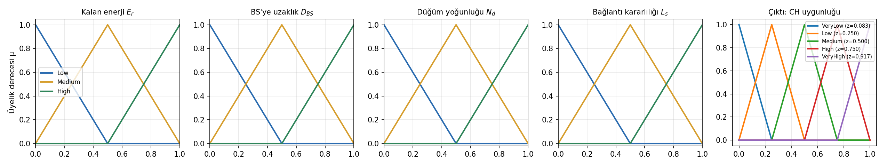

# Adaptif Bulanık Mantık ile IoT Sağlık Ağlarında Enerji Verimli Kümeleme ve Yönlendirme — Yeniden Gerçekleştirme ve Geliştirme

> Bulanık Mantık Dersi Dönem Projesi (2026–2027)

| | |
|---|---|
| **Durum** | 🟡 Checkpoint 3 — Baseline sistem çalışıyor, ilk deney sonuçları üretildi |
| **Dil / Ortam** | Python 3.13 |

---

## Student Information

| | |
|---|---|
| Ad Soyad | Mehmet Kağan Kocadağ |
| Öğrenci No | 1306230083 |
| Ders | Bulanık Mantık |
| Dönem | 2026–2027 |

## Original Paper

R. Manchanda, S. Panchal, R. Sandiri, G. Sudhamsu, A. Mehta, R. Gupta, A. Bhowmik ve B. B. Bukate,
"Energy-efficient clustering and routing for IoT-enabled healthcare using adaptive fuzzy logic and hybrid optimization,"
*Scientific Reports*, vol. 15, Art. no. 34619, 2025. doi: [10.1038/s41598-025-18243-z](https://doi.org/10.1038/s41598-025-18243-z)

Makalenin yazarları kod ve veriyi yayımlamamıştır ("upon reasonable request"). Bu repodaki tüm kodlar makaledeki
tanımlardan **sıfırdan** yazılmıştır. Makalede eksik bırakılan noktalar için alınan kararlar
[docs/checkpoint1_makale_analizi.md](docs/checkpoint1_makale_analizi.md) içinde belgelenmiştir.

## Problem Description

IoT tabanlı sağlık izleme sistemlerinde (giyilebilir sensörler, hasta başı cihazlar) sensör düğümleri pille çalışır.
Verinin baz istasyonuna (BS) enerji verimli, düşük gecikmeli ve güvenilir biçimde iletilmesi gerekir. Kümeleme
yaklaşımında her kümenin bir **küme başı (Cluster Head, CH)** vardır: CH, üyelerden veriyi toplar ve BS'ye iletir.
CH seçimi; enerji, konum, yoğunluk ve bağlantı kalitesi gibi birbiriyle çelişen ve belirsiz ölçütlere bağlıdır.
Bulanık mantık bu tür çok ölçütlü ve belirsiz kararlar için uygun bir araçtır.

## Method

Referans makale iki aşamalı bir model önerir:

1. **Adaptif Bulanık Mantık (AFL) ile CH seçimi.** Dört girdi kullanılır: kalan enerji, BS'ye uzaklık, düğüm
   yoğunluğu ve bağlantı kararlılığı. Üçgen üyelik fonksiyonlarının parametreleri her turda ağın o anki
   dağılımına göre güncellenir. AND işlemi min ile yapılır, durulaştırma ağırlıklı ortalama ile yapılır.
2. **Hibrit PSO-GA ile yönlendirme.** CH'den BS'ye giden çok atlamalı yol PSO ile aranır. Her T iterasyonda
   GA operatörleri (turnuva seçimi, çaprazlama, mutasyon) sürüye çeşitlilik katar.

## Fuzzy System Architecture

```
            ┌──────────────── Adaptif MF güncellemesi (her tur: a=min, b=ort., c=max, λ-yumuşatma)
            ▼
 Er  ─┐   ┌──────────────┐   ┌──────────────┐   ┌───────────────────┐
 DBS ─┼─▶ │ Bulanıklaştır│─▶ │ Kural tabanı │─▶ │ Durulaştırma      │─▶ CH_score(i)
 Nd  ─┤   │ (üçgen MF)   │   │ (min-AND, wk)│   │ (ağırlıklı ortalama)│
 Ls  ─┘   └──────────────┘   └──────────────┘   └───────────────────┘
                                                          │
                       Yerel en yüksek skor ─▶ CH seçimi ─┴─▶ PSO-GA rota optimizasyonu ─▶ BS
```

| Bileşen | Tasarım |
|---|---|
| Girdi MF'leri | Düşük (sol omuz) / Orta (üçgen) / Yüksek (sağ omuz), tek bir (a, b, c) üçlüsüyle; statik (0, 0.5, 1) ya da adaptif |
| Çıktı MF'leri | [0, 1] üzerinde 5 üçgen terim; ağırlık merkezleri z = (0.083, 0.25, 0.5, 0.75, 0.917) |
| Kural tabanı | 81 kural, s = 2·g_E + g_D + g_N + g_L formülüyle sistematik üretilir ([tam tablo](results/tables/rule_base.csv)) |
| Çıkarım | min-AND, kural ağırlıkları w_k |
| Durulaştırma | Ağırlıklı ortalama (makale Denk. 10); karşılaştırma için Mamdani centroid |

Ayrıntılar ve gerekçeler: [docs/checkpoint2_uygulama_plani.md](docs/checkpoint2_uygulama_plani.md).



## Dataset

Ayrıntılar için: [data/README.md](data/README.md). Üç Kaggle sağlık veri seti kullanılır (Healthcare IoT Data,
Health Monitoring System, Patient Temperature and Pulse Rate).

## Installation

```bash
git clone https://github.com/MehmetKaganKocadag/BulanikMantikProjesi.git
cd BulanikMantikProjesi
python -m venv .venv
.venv\Scripts\activate          # Windows  (Linux/macOS: source .venv/bin/activate)
pip install -r requirements.txt
```

## Requirements

Python 3.13 ve [requirements.txt](requirements.txt) içindeki paketler (numpy, pandas, matplotlib, scipy).
Bulanık çıkarım motoru, adaptif MF güncellemesinin tam olarak denetlenebilmesi için hazır bir kütüphane yerine
`src/` altında elle yazılacaktır.

## How to Run

Repo kökünden:

```bash
python -m unittest discover -s tests -v
```

```bash
python experiments/baseline/fis_design.py
```

İlki birim testlerini (32 test) çalıştırır. İkincisi MF grafiklerini, kontrol yüzeyini ve kural tablosunu
`results/` altına üretir.

Yeniden gerçekleştirme deneyleri (veri dosyaları `data/` altında olmalı; bkz. [data/README.md](data/README.md)):

```bash
python experiments/baseline/run_e1.py
```

```bash
python experiments/baseline/run_e2.py
```

```bash
python experiments/baseline/run_e3.py
```

```bash
python experiments/baseline/run_e6.py
```

Deneyler mevcut CPU çekirdeklerini paralel kullanır. 12 çekirdekte E1–E3 birlikte yaklaşık 7 dakika, E6 yaklaşık
12 dakika sürer.

## Reproduction Experiments

| Deney | Makaledeki karşılığı | Kapsam |
|---|---|---|
| E1 | Tablo 4–9, Şekil 12–23 | 4 yöntem × 3 veri seti × 30 tohum × N ∈ {20, 50} |
| E2 | Tablo 10 (inertia weight) | w ∈ {0.3, 0.5, 0.7, 0.9} × 3 veri seti × 30 tohum × N ∈ {20, 50} |
| E3 | "5 düğüm" senaryosu | 4 yöntem × 3 veri seti × 30 tohum |
| E6 | "5/20 = küme başı sayısı" yorumu, Şekil 3–5 | 100 sensör, K ∈ {5, 20} sabit CH × {rastgele, veriden} yerleşim × 5 yöntem (+ k-means) × 3 veri seti × 30 tohum |

Karşılaştırılan yöntemler: **P** (AFL + PSO-GA, makalenin yöntemi), **B2** (statik bulanık + PSO-GA),
**B1** (LEACH + PSO-GA), **B0** (LEACH + doğrudan iletim). Ayrıntılar ve bütün tablolar:
[docs/checkpoint3_baseline.md](docs/checkpoint3_baseline.md).

## Proposed Extension

_(Checkpoint 4'te eklenecek.)_ Aday katkılar [docs/checkpoint1_makale_analizi.md](docs/checkpoint1_makale_analizi.md#8-özgün-katkı-adayları) içinde listelenmiştir.

## Experimental Results

**Yeniden gerçekleştirme (Checkpoint 3):**

- **P, klasik LEACH'e göre** PDR'yi yaklaşık 2 kat, enerji verimliliğini 1.8–2.3 kat artırıyor (p < 0.001).
- **LEACH + PSO-GA ile PDR farkı yok.** Kazancın büyük kısmı yönlendirmeden geliyor; bulanık CH seçimi daha az
  CH seçerek enerji verimliliğini %6–24 artırıyor.
- **Adaptif MF, statik MF'ye göre avantaj sağlamadı** (100 turda %1.5–3.8 daha kötü, çoğu anlamsız).
- **Makalenin parametreleriyle ağ çoğunlukla bölünmüş:** 20 düğümde CH'lerin %39'unun BS'ye yolu yok; PDR 0.59
  (makale: %92.5). 50 düğümde PDR 0.84.
- **Inertia weight'in ağ metriklerine etkisi yok;** makalenin Tablo 10'daki farkları yeniden üretilemedi.
- **Makalenin "5 ve 20 SN" ifadesi belirsiz** (düğüm sayısı mı, küme sayısı mı). İki yorum da test edildi (E6).
  100 sensör ve 5/20 küme başıyla PDR 0.71–0.91'e çıkıyor. Adaptif MF'nin avantajsızlığı iki yorumda da aynı.
  Sabit CH sayısında basit k-means de AFL kadar iyi.


_(Özgün katkı sonuçları Checkpoint 5'te eklenecek.)_

## Limitations

_(Proje ilerledikçe güncellenecek.)_ Referans makalenin bilinen sınırlılıkları ve tutarsızlıkları için:
[Checkpoint 1 analizi, bölüm 7](docs/checkpoint1_makale_analizi.md#7-eleştirel-değerlendirme-tutarsızlıklar-ve-eksikler).

## Repository Structure

```
├── README.md
├── LICENSE
├── requirements.txt
├── .gitignore
├── docs/                    Checkpoint raporları ve tasarım notları
├── src/afl_wsn/             Kaynak kod
│   ├── fuzzy/               Üyelik fonksiyonları, kural tabanı, çıkarım
│   ├── network/             Radyo enerjisi, bağlantı, gecikme, topoloji
│   ├── clustering.py        AFL / statik bulanık / LEACH CH seçimi
│   ├── routing.py           PSO-GA, Dijkstra, yol uygunluğu
│   ├── simulator.py         Tur tabanlı WSN simülatörü
│   ├── traffic.py           Veri setlerinden paket üretimi
│   └── experiment.py        Deney koşucusu ve istatistik
├── tests/                   Birim testleri (unittest)
├── data/                    Veri seti açıklamaları (ham veri gitignore'da)
├── experiments/baseline/    Referans yöntemin yeniden gerçekleştirme deneyleri
├── experiments/proposed/    Özgün katkı deneyleri
├── results/figures/         Üretilen grafikler
├── results/tables/          Üretilen sonuç tabloları (CSV)
├── presentation/            presentation.pdf
├── report/                  report.pdf
└── references/README.md     Kaynakça (IEEE)
```

## References

Bkz. [references/README.md](references/README.md).

## Generative AI Usage Disclosure

Bu projede üretken yapay zekâ araçları (Claude); makale analizi ve uygulama planı taslaklarının hazırlanmasında,
repo iskeletinin oluşturulmasında, bulanık çekirdek, simülatör, yönlendirme ve deney kodlarının ilk
sürümlerinin yazılmasında ve deney sonuçlarının raporlanmasında yardımcı olarak kullanılmıştır. Tüm içerik öğrenci tarafından okunup doğrulanmaktadır. Kullanımın
ayrıntıları proje ilerledikçe bu bölüme ve teknik rapora eklenecektir.
