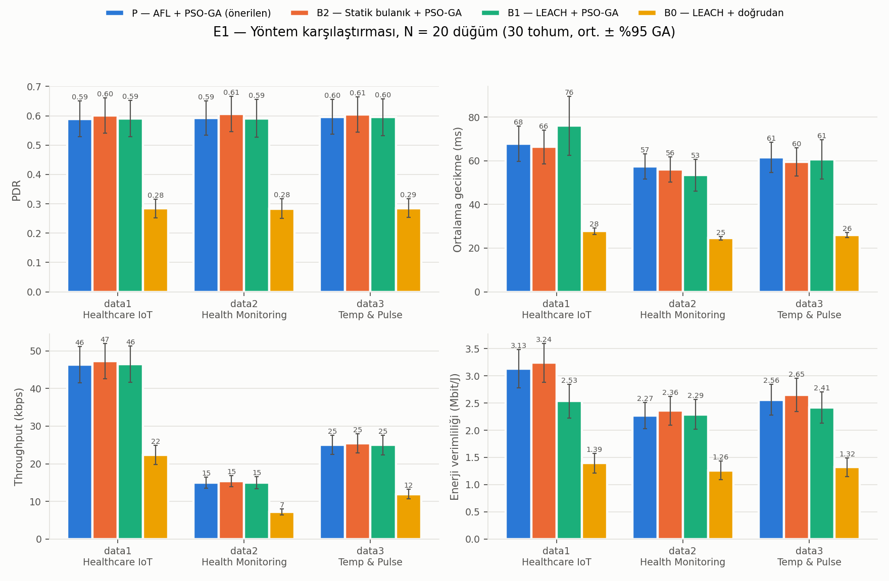
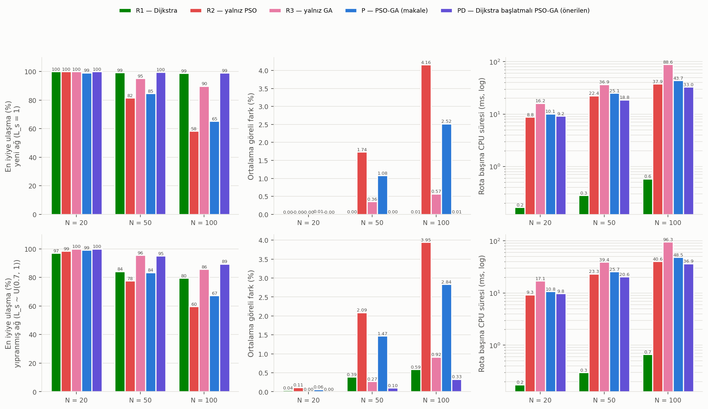

# Adaptif Bulanık Mantık ile IoT Sağlık Ağlarında Enerji Verimli Kümeleme ve Yönlendirme — Yeniden Gerçekleştirme ve Geliştirme

> Bulanık Mantık Dersi Dönem Projesi (2026–2027)

| | |
|---|---|
| **Durum** | 🟢 Final — Teknik rapor ([report/report.pdf](report/report.pdf)) ve sunum ([presentation/presentation.pdf](presentation/presentation.pdf)) hazır |
| **Dil / Ortam** | Python 3.13 |

---

## Student Information

| | |
|---|---|
| Ad Soyad | Mehmet Kağan Kocadağ |
| Öğrenci No | 1306230083 |
| Ders | Bulanık Mantık |
| Dönem | 2026–2027 |

## Original Paper

R. Manchanda, S. Panchal, R. Sandiri, G. Sudhamsu, A. Mehta, R. Gupta, A. Bhowmik ve B. B. Bukate,
"Energy-efficient clustering and routing for IoT-enabled healthcare using adaptive fuzzy logic and hybrid optimization,"
*Scientific Reports*, vol. 15, Art. no. 34619, 2025. doi: [10.1038/s41598-025-18243-z](https://doi.org/10.1038/s41598-025-18243-z)

Makalenin yazarları kod ve veriyi yayımlamamıştır ("upon reasonable request"). Bu repodaki tüm kodlar makaledeki
tanımlardan **sıfırdan** yazılmıştır. Makalede eksik bırakılan noktalar için alınan kararlar
[docs/checkpoint1_makale_analizi.md](docs/checkpoint1_makale_analizi.md) içinde belgelenmiştir.

## Problem Description

IoT tabanlı sağlık izleme sistemlerinde (giyilebilir sensörler, hasta başı cihazlar) sensör düğümleri pille çalışır.
Verinin baz istasyonuna (BS) enerji verimli, düşük gecikmeli ve güvenilir biçimde iletilmesi gerekir. Kümeleme
yaklaşımında her kümenin bir **küme başı (Cluster Head, CH)** vardır: CH, üyelerden veriyi toplar ve BS'ye iletir.
CH seçimi; enerji, konum, yoğunluk ve bağlantı kalitesi gibi birbiriyle çelişen ve belirsiz ölçütlere bağlıdır.
Bulanık mantık bu tür çok ölçütlü ve belirsiz kararlar için uygun bir araçtır.

## Method

Referans makale iki aşamalı bir model önerir:

1. **Adaptif Bulanık Mantık (AFL) ile CH seçimi.** Dört girdi kullanılır: kalan enerji, BS'ye uzaklık, düğüm
   yoğunluğu ve bağlantı kararlılığı. Üçgen üyelik fonksiyonlarının parametreleri her turda ağın o anki
   dağılımına göre güncellenir. AND işlemi min ile yapılır, durulaştırma ağırlıklı ortalama ile yapılır.
2. **Hibrit PSO-GA ile yönlendirme.** CH'den BS'ye giden çok atlamalı yol PSO ile aranır. Her T iterasyonda
   GA operatörleri (turnuva seçimi, çaprazlama, mutasyon) sürüye çeşitlilik katar.

## Fuzzy System Architecture

```
            ┌──────────────── Adaptif MF güncellemesi (her tur: a=min, b=ort., c=max, λ-yumuşatma)
            ▼
 Er  ─┐   ┌──────────────┐   ┌──────────────┐   ┌───────────────────┐
 DBS ─┼─▶ │ Bulanıklaştır│─▶ │ Kural tabanı │─▶ │ Durulaştırma      │─▶ CH_score(i)
 Nd  ─┤   │ (üçgen MF)   │   │ (min-AND, wk)│   │ (ağırlıklı ortalama)│
 Ls  ─┘   └──────────────┘   └──────────────┘   └───────────────────┘
                                                          │
                       Yerel en yüksek skor ─▶ CH seçimi ─┴─▶ PSO-GA rota optimizasyonu ─▶ BS
```

| Bileşen | Tasarım |
|---|---|
| Girdi MF'leri | Düşük (sol omuz) / Orta (üçgen) / Yüksek (sağ omuz), tek bir (a, b, c) üçlüsüyle; statik (0, 0.5, 1) ya da adaptif |
| Çıktı MF'leri | [0, 1] üzerinde 5 üçgen terim; ağırlık merkezleri z = (0.083, 0.25, 0.5, 0.75, 0.917) |
| Kural tabanı | 81 kural, s = 2·g_E + g_D + g_N + g_L formülüyle sistematik üretilir ([tam tablo](results/tables/rule_base.csv)) |
| Çıkarım | min-AND, kural ağırlıkları w_k |
| Durulaştırma | Ağırlıklı ortalama (makale Denk. 10); karşılaştırma için Mamdani centroid |

Ayrıntılar ve gerekçeler: [docs/checkpoint2_uygulama_plani.md](docs/checkpoint2_uygulama_plani.md).


## Dataset

Ayrıntılar için: [data/README.md](data/README.md). Üç Kaggle sağlık veri seti kullanılır (Healthcare IoT Data,
Health Monitoring System, Patient Temperature and Pulse Rate).

## Installation

```bash
git clone https://github.com/MehmetKaganKocadag/BulanikMantikProjesi.git
cd BulanikMantikProjesi
python -m venv .venv
.venv\Scripts\activate          # Windows  (Linux/macOS: source .venv/bin/activate)
pip install -r requirements.txt
```

## Requirements

Python 3.13 ve [requirements.txt](requirements.txt) içindeki paketler (numpy, pandas, matplotlib, scipy).
Bulanık çıkarım motoru, adaptif MF güncellemesinin tam olarak denetlenebilmesi için hazır bir kütüphane yerine
`src/` altında elle yazılacaktır.

## How to Run

Repo kökünden:

```bash
python -m unittest discover -s tests -v
```

```bash
python experiments/baseline/fis_design.py
```

İlki birim testlerini (40 test) çalıştırır. İkincisi MF grafiklerini, kontrol yüzeyini ve kural tablosunu
`results/` altına üretir.

Yeniden gerçekleştirme deneyleri (veri dosyaları `data/` altında olmalı; bkz. [data/README.md](data/README.md)):

```bash
python experiments/baseline/run_e1.py
```

```bash
python experiments/baseline/run_e2.py
```

```bash
python experiments/baseline/run_e3.py
```

```bash
python experiments/baseline/run_e6.py
```

Özgün katkı deneyleri:

```bash
python experiments/proposed/run_k1.py
```

```bash
python experiments/proposed/run_k6.py
```

Deneyler mevcut CPU çekirdeklerini paralel kullanır ve ilerlemeyi ekrana yazar. 12 çekirdekte yaklaşık süreler:
E1–E3 birlikte 7 dakika, E6 12 dakika, K1 40 dakika, K6 4 dakika. E6, K1 ve K6 betikleri `--analyze`
seçeneğiyle koşuları tekrarlamadan yalnızca tabloları ve grafikleri yeniden üretir.

Canlı demo (bulanık çıkarım adım adım, yönlendirme karşılaştırması ve küçük bir ağ simülasyonu):

```bash
python experiments/demo.py
```

```bash
python experiments/demo.py fis 0.9 0.3 0.4 0.95 --adaptive 0.85 0.98
```

Rapor ve sunum, deney çıktılarından yeniden üretilebilir (PDF dönüşümü Windows'ta Word ve PowerPoint ister):

```bash
python report/build_report.py
```

```bash
python presentation/build_presentation.py
```

## Reproduction Experiments

| Deney | Makaledeki karşılığı | Kapsam |
|---|---|---|
| E1 | Tablo 4–9, Şekil 12–23 | 4 yöntem × 3 veri seti × 30 tohum × N ∈ {20, 50} |
| E2 | Tablo 10 (inertia weight) | w ∈ {0.3, 0.5, 0.7, 0.9} × 3 veri seti × 30 tohum × N ∈ {20, 50} |
| E3 | "5 düğüm" senaryosu | 4 yöntem × 3 veri seti × 30 tohum |
| E6 | "5/20 = küme başı sayısı" yorumu, Şekil 3–5 | 100 sensör, K ∈ {5, 20} sabit CH × {rastgele, veriden} yerleşim × 5 yöntem (+ k-means) × 3 veri seti × 30 tohum |

Karşılaştırılan yöntemler: **P** (AFL + PSO-GA, makalenin yöntemi), **B2** (statik bulanık + PSO-GA),
**B1** (LEACH + PSO-GA), **B0** (LEACH + doğrudan iletim). Ayrıntılar ve bütün tablolar:
[docs/checkpoint3_baseline.md](docs/checkpoint3_baseline.md).

## Proposed Extension

Ayrıntılar: [Checkpoint 4 — Katkı Önerisi](docs/checkpoint4_katki_onerisi.md). Hipotezler ve başarı
ölçütleri deneylerden önce orada sabitlendi.

| Katkı | Ne değişiyor | Neden | Baseline |
|---|---|---|---|
| **K1 — Hibrit adaptif MF (PH)** | Adaptif bölümleme statik bölümlemeye ρ oranında çekiliyor: (1 − ρ)·adaptif + ρ·(0, 0.5, 1). ρ ayrı tohumlarda seçiliyor. Ağ ömrü (son düğüm ölene kadar), homojen ve heterojen başlangıç enerjisiyle ölçülüyor | Adaptif MF, dar enerji bandını bütün terim aralığına yayıp önemsiz farkları büyütüyordu (CP3) | P (makalenin adaptif MF'si), B2 (statik MF) |
| **K6 — Dijkstra başlatmalı PSO-GA (PD)** | Sürünün ilk parçacığı Dijkstra'nın yolunu kodluyor. Ayrıca yönlendirme ablasyonu: Dijkstra, yalnız PSO, yalnız GA, PSO-GA, doğrudan iletim | PSO-GA'nın bileşenleri ayrı ayrı test edilmemişti; Dijkstra 40–90 kat ucuzdu (CP3) | P (makalenin PSO-GA'sı) |

## Experimental Results

**Yeniden gerçekleştirme (Checkpoint 3):**

- **P, klasik LEACH'e göre** PDR'yi yaklaşık 2 kat, enerji verimliliğini 1.8–2.3 kat artırıyor (p < 0.001).
- **LEACH + PSO-GA ile PDR farkı yok.** Kazancın büyük kısmı yönlendirmeden geliyor; bulanık CH seçimi daha az
  CH seçerek enerji verimliliğini %6–24 artırıyor.
- **Adaptif MF, statik MF'ye göre avantaj sağlamadı** (100 turda %1.5–3.8 daha kötü, çoğu anlamsız).
- **Makalenin parametreleriyle ağ çoğunlukla bölünmüş:** 20 düğümde CH'lerin %39'unun BS'ye yolu yok; PDR 0.59
  (makale: %92.5). 50 düğümde PDR 0.84.
- **Inertia weight'in ağ metriklerine etkisi yok;** makalenin Tablo 10'daki farkları yeniden üretilemedi.
- **Makalenin "5 ve 20 SN" ifadesi belirsiz** (düğüm sayısı mı, küme sayısı mı). İki yorum da test edildi (E6).
  100 sensör ve 5/20 küme başıyla PDR 0.71–0.91'e çıkıyor. Adaptif MF'nin avantajsızlığı iki yorumda da aynı.
  Sabit CH sayısında basit k-means de AFL kadar iyi.



**Özgün katkılar (Checkpoint 5):** Ayrıntılar: [docs/checkpoint5_deneysel_sonuclar.md](docs/checkpoint5_deneysel_sonuclar.md).

| Ölçüt | Baseline | Geliştirilen | Değişim |
|---|---|---|---|
| K1 — Ağ ömrü boyunca teslim edilen okuma | P: 9020 | PH: 8945 | −0.8% (anlamsız) |
| K6 — En iyi rotaya ulaşma (N = 100, yıpranmış ağ) | P: %67.3 | PD: %89.5 | +22.2 puan |
| K6 — Rota başına CPU süresi (N = 100, yıpranmış ağ) | P: 48.5 ms | PD: 36.9 ms | −24% |

- **K1 başarı ölçütünü karşılamadı.** Hibrit MF, adaptif ya da statik MF'den anlamlı biçimde iyi değil. Ağ
  ömrü boyunca adaptif MF statik MF'nin biraz önüne geçiyor (%0.4–1.5). MF değişikliklerinin etkisi sınırlı,
  çünkü CH seçimi skorların sıralamasına dayanıyor ve bütün bölümlemeler her girdide monoton.
- **K6 başarı ölçütünü karşıladı.** PD en iyi rotayı her ağ boyutunda P'den daha sık, daha ucuza buluyor ve
  Dijkstra'dan hiçbir zaman kötü değil. Ağ düzeyinde ise bütün optimizasyon yöntemleri aynı PDR ve enerji
  verimliliğini veriyor; Dijkstra 40–81 kat daha ucuz.



## Limitations

- **Model varsayımları:** Kanal, bağlantı, gecikme ve trafik modelleri makalede tanımlı değil; bu projede
  varsayıldı ([CP2](docs/checkpoint2_uygulama_plani.md)). Sonuçlar mutlak değerler olarak değil, aynı
  simülatördeki göreli karşılaştırmalar olarak okunmalı.
- **Farklı rakipler:** Makalenin karşılaştırdığı ANFIS, QPSO ve ECPF'nin kodu yok; yerine aynı simülatörde LEACH
  tabanlı baseline'lar kullanıldı.
- **İdeal varsayımlar:** Tek kanal, çarpışma yok, kontrol paketlerinin enerjisi ihmal edildi.
- **Erken durma:** PSO tabanlı yöntemlerde 20 iterasyonluk sabır bu projenin varsayımı.
- **K1 ölçeği:** Yalnızca N = 50 ve E₀ = 0.25 J denendi.

Referans makalenin tutarsızlıkları (T1–T24): [Checkpoint 1 analizi, bölüm 7](docs/checkpoint1_makale_analizi.md#7-eleştirel-değerlendirme-tutarsızlıklar-ve-eksikler).

## Repository Structure

```
├── README.md
├── LICENSE
├── requirements.txt
├── .gitignore
├── docs/                    Checkpoint 1–5 belgeleri ve literatür taraması
├── src/afl_wsn/             Kaynak kod
│   ├── fuzzy/               Üyelik fonksiyonları, kural tabanı, çıkarım
│   ├── network/             Radyo enerjisi, bağlantı, gecikme, topoloji
│   ├── clustering.py        AFL / statik bulanık / LEACH CH seçimi
│   ├── routing.py           PSO-GA, Dijkstra, yol uygunluğu
│   ├── simulator.py         Tur tabanlı WSN simülatörü
│   ├── traffic.py           Veri setlerinden paket üretimi
│   └── experiment.py        Deney koşucusu ve istatistik
├── tests/                   Birim testleri (unittest)
├── data/                    Veri seti açıklamaları (ham veri gitignore'da)
├── experiments/baseline/    Referans yöntemin yeniden gerçekleştirme deneyleri
├── experiments/proposed/    Özgün katkı deneyleri (K1, K6)
├── experiments/demo.py      Canlı demo
├── results/figures/         Üretilen grafikler
├── results/tables/          Üretilen sonuç tabloları (CSV)
├── presentation/            presentation.pdf (+ .pptx ve üretici betik)
├── report/                  report.pdf (+ .docx ve üretici betik)
└── references/README.md     Kaynakça (IEEE)
```

## References

IEEE formatında, bütün künyeleri Crossref'te DOI ile doğrulanmış kaynakça:
[references/README.md](references/README.md). Güncel literatürün (2022–2026) değerlendirmesi:
[docs/literatur_taramasi.md](docs/literatur_taramasi.md).

## Generative AI Usage Disclosure

Referans makale öğrenci tarafından okunmuş ve incelenmiştir. Bu projede Anthropic'in Claude modeli (Claude Code
ortamında) yardımcı araç olarak kullanılmıştır:
- makale analizi, tutarsızlıkların belirlenmesi ve uygulama planı taslakları;
- repo iskeleti; bulanık çekirdek, simülatör, yönlendirme ve deney kodlarının ilk sürümleri ve birim testleri;
- özgün katkıların (K1, K6) tasarımı ve kodlanması;
- literatür taramasında aday çalışmaların bulunması (bütün künyeler Crossref'te DOI ile doğrulandı,
  doğrulanamayan adaylar kullanılmadı);
- grafikler, checkpoint belgeleri, teknik rapor ve sunumun taslakları.

Raporlanan bütün sonuçlar depodaki betiklerle üretilmiştir ve yeniden üretilebilir. Kodun, deneylerin ve
metnin doğruluğundan öğrenci sorumludur. Aynı beyan teknik raporda da yer almaktadır.
