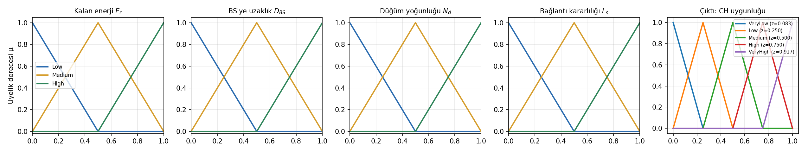
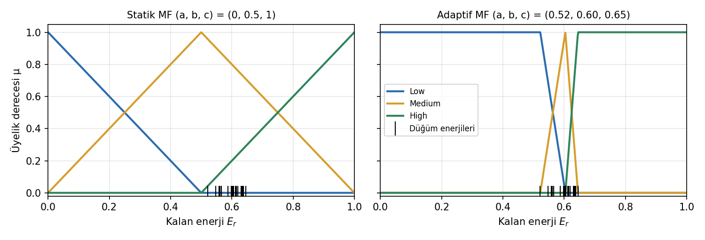
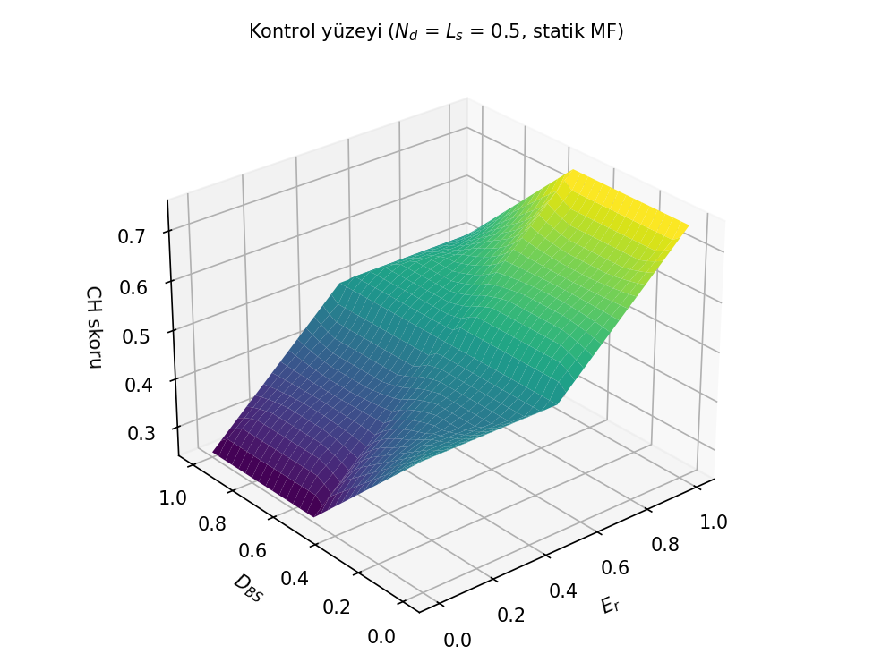
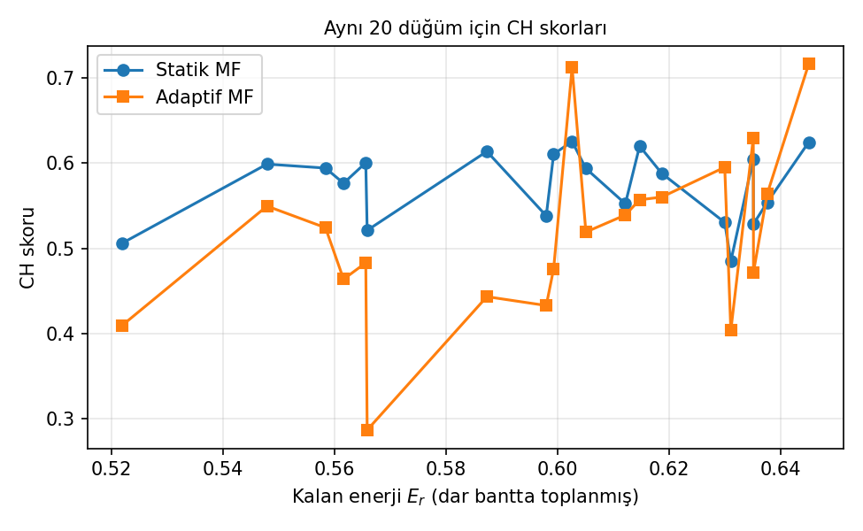

# Checkpoint 2 — Uygulama Planı

> **Yönerge (CP2):** Geliştirme ortamı, veri seti, membership function yapıları, rule base ve deney planı
> belirlenecektir.
>
> Bu belge, Checkpoint 1'in 9. bölümündeki taslak kararları kesinleştirir. Bulanık çekirdek (MF'ler, kural
> tabanı, çıkarım) bu aşamada **kodlandı ve test edildi.** Simülatör ve PSO-GA, Checkpoint 3'te bu plana göre
> yazılacak. Makaleye yapılan denklem, tablo ve şekil atıfları makalenin kendi numaralarıdır.

---

## 1. Geliştirme ortamı

| Bileşen | Seçim | Not |
|---|---|---|
| Dil | Python 3.13 | Makale MATLAB + Colab kullanmış. Python açık kaynak ve her ortamda çalışabilir |
| Kütüphaneler | numpy 2.2.5, pandas 2.2.3, matplotlib 3.10.1, scipy 1.15.2 | [requirements.txt](../requirements.txt) |
| Bulanık motor | Elle yazıldı (`src/afl_wsn/fuzzy`) | Adaptif MF'ler ve kural ağırlıkları hazır kütüphanelerde (ör. scikit-fuzzy) bu biçimde desteklenmez. Elle yazılan motorda her adım şeffaf ve test edilebilir |
| Testler | `unittest` (standart kütüphane) | `python -m unittest discover -s tests -v` |
| Tekrar üretilebilirlik | Her deney sabit tohum listesiyle (`numpy.random.default_rng(seed)`) | Tohumlar sonuç dosyalarına yazılır |

## 2. Yazılım mimarisi

```
src/afl_wsn/
├── fuzzy/                 ✅ CP2'de yazıldı
│   ├── membership.py      Üçgen/omuz MF, statik ve adaptif üç terimli bölümleme (Denk. 1, 6)
│   ├── rulebase.py        81 kuralın sistematik üretimi
│   └── fis.py             Çıkarım (Denk. 9), durulaştırma (Denk. 10 + Mamdani centroid)
├── network/               ⏳ CP3
│   ├── radio.py           Birinci derece radyo enerji modeli
│   ├── link.py            Bağlantı başarı olasılığı, ACK tabanlı L_s takibi
│   ├── traffic.py         Kaggle verisinden paket üretimi
│   └── simulator.py       Tur döngüsü, ölüm takibi, metrik toplama
├── clustering/            ⏳ CP3
│   ├── afl.py             Girdi hesaplama (Denk. 2–5), FIS ile skor, yerel-maksimum CH seçimi
│   └── leach.py           LEACH baseline
├── routing/               ⏳ CP3
│   ├── encoding.py        Rastgele anahtar → yol çözümleme
│   ├── fitness.py         Denk. 14–19 (normalize)
│   ├── pso_ga.py          Hibrit PSO-GA (+ yalnız-PSO, yalnız-GA modları)
│   └── dijkstra.py        Kesin en kısa yol referansı
└── metrics.py             PDR, gecikme, throughput, EE, FND/HND/LND
```

## 3. Ağ ve kanal modeli

### 3.1 Topoloji

- **Alan ve düğümler:** 100 × 100 m² alana N düğüm düzgün rastgele yerleştirilir (tohuma bağlı).
- **BS konumu:** BS (50, 50) noktasındadır. BS'ye olası en büyük uzaklık $d_{max}=\sqrt{50^2+50^2}=70.71$ m
  (Denk. 3'teki $d_{max}$).
- **İletişim menzili:** R = 25 m. Komşuluk ve yönlendirme grafiği bu menzille kurulur.
- **"5 ve 20 düğüm" belirsizliği:** CP1, T8'de tartışıldı. Makaleye sadık kalmak için N ∈ {5, 20} çalıştırılır.
  Ancak N = 5'te ağ çoğunlukla bağlantısızdır (CP1, T9), bu yüzden ana sonuçlar N = 20 üzerinden verilir.
  Ölçeklenebilirlik için 50, 100 ve 200 düğüm de denenir (K5).

### 3.2 Enerji modeli (Heinzelman birinci derece radyo modeli)

Makaledeki Denk. 16 hatalı olduğu için (CP1, T4) standart model kullanılır. k bit için:

```math
E_{TX}(k,d)=\begin{cases}E_{elec}k+\epsilon_{fs}kd^2 & d<d_0\\ E_{elec}k+\epsilon_{mp}kd^4 & d\ge d_0\end{cases}
\qquad E_{RX}(k)=E_{elec}k \qquad d_0=\sqrt{\epsilon_{fs}/\epsilon_{mp}}
```

| Parametre | Değer | Kaynak |
|---|---|---|
| $E_{elec}$ | 50 nJ/bit | Makale Tablo 3 |
| $\epsilon_{fs}$ | 100 pJ/bit/m² | Makale Tablo 3 ("ε_amp") |
| $\epsilon_{mp}$ | 0.0013 pJ/bit/m⁴ | Varsayım (LEACH literatüründeki yaygın değer). Bu değerle d₀ ≈ 277 m çıkar, yani alan içinde fiilen hep serbest uzay modu geçerlidir |
| $E_{DA}$ | 5 nJ/bit/sinyal | Makale Tablo 3 |
| Paket | 512 byte = 4096 bit | Makale Tablo 3 |
| Başlangıç enerjisi | 2 J | Makale Tablo 3. Ömür deneyinde (E4) çalışma süresini makul tutmak için 0.25 J'ye ölçeklenir; göreli karşılaştırmayı etkilemez |

**Tur başına harcamalar:**
- **Üye düğüm:** CH'ye 1 paket gönderir.
- **CH:**
  - Her üyeden 1 paket alır.
  - (üye sayısı + 1) sinyali birleştirir.
  - Birleştirilmiş 1 paketi rota üzerinden gönderir.
- **Ara (röle) düğüm:** Geçen her paket için alım ve gönderim maliyeti öder.

### 3.3 Bağlantı modeli

- **Başarı olasılığı:** Mesafeye bağlı lojistik eğri. Her iletim bu olasılıkla bağımsız Bernoulli denemesidir
  (ARQ yok):

  ```math
  p(d)=\frac{p_{max}}{1+\exp\left((d-d_{50})/\sigma\right)}
  ```

  Parametreler: $p_{max}$ = 0.98, $d_{50}$ = 30 m, σ = 3 m.

  | d | 10 m | 20 m | 25 m (menzil) | 30 m | 40 m |
  |---|---|---|---|---|---|
  | p(d) | ≈ 0.98 | ≈ 0.95 | ≈ 0.82 | 0.49 | ≈ 0.03 |

  Menzil içindeki kısa atlamalar güvenilir, menzil sınırındakiler zayıftır. Makalenin şekillerindeki
  ~0.90 civarı PDR, 2–3 atlamalık yollarla tutarlıdır.
- **Düğüm bağlantı kararlılığı $L_s(i)$ (Denk. 5):** Düğümün kendi iletimlerinin ACK oranı, üstel hareketli
  ortalamayla tutulur: $L_s \leftarrow 0.9 L_s + 0.1 a$; burada ACK alındıysa a = 1, alınmadıysa a = 0.
  Başlangıç değeri 1.0. Bu, CP1 T16'nın yorumudur.
- **Yönlendiricinin tahmini:** Yönlendirici gerçek olasılıkları bilmez. Bir bağlantının PDR tahmini olarak
  p(d) kullanılır (RSSI'dan kestirilebilir varsayımı). Bağlantının kararlılığı için gönderen düğümün $L_s$
  değeri kullanılır.

### 3.4 Gecikme modeli

Bir atlamanın gecikmesi:

```math
T_{hop}=\underbrace{k/R_b}_{\text{iletim}}+\underbrace{d/c}_{\text{yayılma}}+\underbrace{t_{proc}}_{\text{işlem}}+\underbrace{q\cdot k/R_b}_{\text{kuyruk}}
```

| Terim | Değer / tanım |
|---|---|
| $R_b$ | 250 kbps (IEEE 802.15.4) |
| $k/R_b$ | 4096 / 250 000 ≈ 16.4 ms |
| $c$ | 3·10⁸ m/s |
| $t_{proc}$ | 1 ms |
| q | Aynı turda o röleden daha önce geçen paket sayısı (FIFO) |

Uçtan uca gecikme atlamaların **toplamıdır** (Denk. 17). Makaledeki Denk. 26'nın atlama başına ortalaması da
ayrıca raporlanır (CP1, T6).

### 3.5 Trafik ve veri setlerinin kullanımı

Makale Kaggle verisinin ağa nasıl eşlendiğini açıklamaz (CP1, E7). Fiziksel olarak anlamlı tek yorum, verinin
**trafik kaynağı** olmasıdır:

- **Akış ataması:** İncelenen dosyalarda hasta başına uzun zaman serisi yok. data1'de hasta başına ortalama
  10 kayıt var, data2'de yalnızca 2 hasta, data3'te ise hasta kimliği hiç yok. Bu yüzden "her düğüm bir hasta"
  eşlemesi mümkün değil. Bunun yerine:
  - Her veri seti, zamana göre sıralanmış ve ön işlenmiş tek bir kayıt akışı olarak ele alınır.
  - Düğüm i bu akışı kendine özgü bir ofsetten okur: tur t'de `(ofset_i + t) mod L` numaralı satır
    (L: satır sayısı).
  - Ofsetler tohuma bağlı rastgele seçilir.
  - Her tur bir örnekleme anıdır ($T_{round}$ = 1 s).
- **Raporlama politikası — send-on-delta + kalp atışı:** Düğüm şu durumlardan birinde paket üretir:
  1. Herhangi bir ölçüm, son gönderilen değere göre 0.5 standart sapmadan fazla değişmişse,
  2. Herhangi bir ölçüm anormalse (|z| > 2),
  3. Son 10 turda hiç paket göndermemişse (kalp atışı).

  Eşikler bpm ya da °C gibi klinik birimlerle değil **z-skorla** tanımlanır, çünkü data3'teki nabız ham ADC
  değeridir ve data2'deki sütunlar da fizyolojik birimde değildir (bkz. [data/README.md](../data/README.md)).
- **Kullanılan sütunlar:**

  | Veri seti | Sütunlar |
  |---|---|
  | data1 | Temperature, Systolic_BP, Diastolic_BP, Heart_Rate |
  | data2 | Temperature Data, ECG Data, Pressure Data |
  | data3 | Temp, Pulse |
- **Sonuç:** Veri setleri ağ yükü üzerinden sonuçları etkiler (paket sayısı → enerji ve kuyruk gecikmesi).
  Bu nedenle sonuçlar veri seti bazında raporlanabilir.
- **Basit mod:** Doğrulama için bir "periyodik" mod da vardır: her tur her düğüm paket gönderir.
- **Veri yoksa:** Veri dosyaları bulunmazsa sentetik bir akış üreteci devreye girer, böylece kod veri olmadan
  da çalışır.

> Veri setlerinin içeriği, makaledeki tanımlarla uyuşmadığı noktalar ve ön işleme adımları için:
> [data/README.md](../data/README.md).

## 4. Bulanık CH seçim sistemi

### 4.1 Girdiler

Denk. 2–5 makaledeki gibi uygulanır; her biri [0, 1] aralığındadır:

| Girdi | Hesaplama | "İyi" yön |
|---|---|---|
| $E_r$ | Kalan enerji / başlangıç enerjisi | Yüksek |
| $D_{BS}$ | d(i, BS) / 70.71 | **Düşük** |
| $N_d$ | 25 m içindeki canlı komşu sayısı / N | Yüksek |
| $L_s$ | ACK oranının üstel hareketli ortalaması (§3.3) | Yüksek |

### 4.2 Üyelik fonksiyonları

Her girdi tek bir (a, b, c) üçlüsüyle tanımlanan üç terime sahiptir:

| Terim | MF | Tanım |
|---|---|---|
| Düşük | Sol omuz | x ≤ a için 1, b'de 0 |
| Orta | Üçgen | (a, b, c) — Denk. 6 |
| Yüksek | Sağ omuz | b'de 0, x ≥ c için 1 |

- **Neden omuz:** Makaledeki saf üçgen, c = max seçildiğinde en iyi düğümün "Yüksek" üyeliğini 0 yapardı.
  Omuz MF'ler bu sorunu giderir.
- **Ruspini bölümlemesi:** Üç üyeliğin toplamı her noktada 1'dir (birim testle doğrulandı).

**Statik ve adaptif bölümleme:**

| Mod | (a, b, c) | Kullanım |
|---|---|---|
| Statik | (0, 0.5, 1), sabit | K1 ablasyonunun karşılaştırma tarafı |
| Adaptif (makale) | Her tur: a = min, c = max, b = medyan; λ = 0.7 ile yumuşatma (Denk. 1) | Önerilen yöntem |

Adaptif modda iki ek güvenlik vardır:
- **Minimum genişlik:** c − a ≥ 0.05. İlk turda bütün enerjiler 1.0 olduğunda bölümlemenin çökmesini önler.
- **Merkezin sınırlandırılması:** b, [a, c] aralığının içinde tutulur.





*Şekil — Enerjiler dar bir bantta toplandığında (0.52–0.65) statik MF'ler bütün düğümleri neredeyse aynı
"Orta" derecesinde görür. Adaptif MF ise bandı üç terime yayar.*

### 4.3 Çıktı

- **Terimler:** CH uygunluğu için [0, 1] üzerinde 5 terim: Çok Düşük, Düşük, Orta, Yüksek, Çok Yüksek.
  Tepe noktaları 0, 0.25, 0.5, 0.75 ve 1'dedir; üçgenlerin yarı genişliği 0.25, uç terimler sınırda kesiktir.
- **$z_k$ değerleri:** Makaledeki tanıma uygun olarak her çıktı kümesinin **ağırlık merkezi** alınır:
  $z$ = (0.083, 0.25, 0.5, 0.75, 0.917).

### 4.4 Kural tabanı (81 kural)

Kurallar tek bir formülle üretilir ([rulebase.py](../src/afl_wsn/fuzzy/rulebase.py)):

1. **İyilik seviyesi:** Her girdi terimine g ∈ {0, 1, 2} verilir. Yüksek = 2'dir; mesafede yön terstir
   (Düşük mesafe = 2).
2. **Ağırlıklı toplam:** $s = 2\,g_E + g_D + g_N + g_L$, aralığı [0, 10]. Enerjinin ağırlığı 2'dir, çünkü CH
   rolü (alım, birleştirme, iletim) en çok enerji harcayan roldür. Tükenmek üzere olan bir düğümün CH olması
   ağ ömrünü doğrudan kısaltır.
3. **Çıktı terimi:** Z = round(4·s/10).

| Çıktı terimi | Çok Düşük | Düşük | Orta | Yüksek | Çok Yüksek |
|---|---|---|---|---|---|
| Kural sayısı | 4 | 17 | 39 | 17 | 4 |

**Örnek kurallar:**
- `IF Er is High AND DBS is Low AND Nd is High AND Ls is High THEN CH is VeryHigh`
- `IF Er is Low AND DBS is High AND Nd is Low AND Ls is Low THEN CH is VeryLow`
- **Garanti:** Enerjisi Düşük olan bir düğüm hiçbir kombinasyonda Orta'nın üzerine çıkamaz
  (birim testle doğrulandı).

Tam tablo: [results/tables/rule_base.csv](../results/tables/rule_base.csv).

> **Not:** Kural sayısı girdi sayısıyla üstel büyür (3⁴ = 81, "kural patlaması"). İndirgenmiş bir kural tabanı
> (ör. yalnızca enerji ve mesafe) ablasyon olarak ileride denenebilir.

### 4.5 Çıkarım ve durulaştırma

| Adım | Yöntem |
|---|---|
| AND (t-norm) | min (Denk. 9) |
| Kural ağırlığı | $w_k = 1$ (temel model) |
| Durulaştırma — temel | **Ağırlıklı ortalama**, makale Denk. 10'un birebir karşılığı |
| Durulaştırma — K2 için | **Mamdani centroid:** her çıktı teriminde max ile birleştirilmiş ateşleme gücüyle MF'yi kırp, max-birleşim al, ağırlık merkezini 1001 noktalı ızgarada hesapla |



*Şekil — CH skoru enerjiyle monoton artar, mesafeyle monoton azalır (birim testlerle doğrulandı). Yüzeydeki
kırılmalar, 5 çıktı terimine yuvarlanan kural tabanının basamaklı yapısından gelir.*

### 4.6 Kural ağırlığı öğrenme (Denk. 8) — K2 kapsamında

- **Makalenin formülü:** $w_k \leftarrow w_k + \eta\,\partial J/\partial w_k$. İşareti hatalıdır (CP1, T1).
- **Bizim uygulamamız:** İşaret düzeltilir ve ağırlıkların negatif olması engellenir:

  ```math
  w_k \leftarrow \max\left(0,\ w_k - \eta\, g_k\right)
  ```

  Burada $g_k$, $\partial J/\partial w_k$ gradyanının tahminidir.
  - J = α·E_total + β·Delay + γ·(1−PDR) (Denk. 7), bir yeniden kümeleme dönemi boyunca ölçülür.
  - J simülasyon çıktısı olduğu için gradyan **SPSA** ile kestirilir: tüm ağırlıklar aynı anda rastgele ±c
    kadar bozulur ve iki J ölçümünden tahmin yapılır.
- **Kapsam:** Temel modelde kapalıdır, K2 deneyinde açılır.

### 4.7 CH seçimi ve küme oluşumu

1. **Bölümleme güncellemesi:** Tur başında canlı düğümlerin girdileri hesaplanır ve adaptif bölümlemeler
   güncellenir (yalnızca adaptif modda).
2. **Uygunluk eşiği:** Bir düğüm ancak $E_r \ge 0.05$ ise CH adayı olabilir.
3. **Yerel maksimum kuralı** (makaledeki "yerel bölgesinde en yüksek skor"): Aday düğüm, 25 m içindeki bütün
   canlı aday komşularından yüksek skora sahipse CH olur. Eşitlikte enerji, sonra düğüm numarası belirler.
4. **Kümelere katılım:** CH olmayan düğüm, menzilindeki CH'ler arasından p(d) değeri en yüksek olana
   (pratikte en yakın olana) katılır.
5. **Yedek kural:** Menzilinde hiç CH bulunmayan düğüm kendi kümesinin CH'si olur.
6. **Yeniden kümeleme:** Her 10 turda bir (dönem), ya da bir CH'nin enerjisi dönem başındaki değerinin
   %80'inin altına düşerse (makale Algoritma 1, satır 49–54).

## 5. Hibrit PSO-GA yönlendirme

### 5.1 Yol kodlaması: rastgele anahtar (random-key / priority encoding)

- **Parçacık:** Her parçacık bir vektördür: $x \in [0,10]^{N+1}$, yani düğüm başına bir öncelik ve BS için
  bir öncelik.
- **Çözümleme:**
  1. Mevcut düğüm = CH.
  2. Menzildeki **ziyaret edilmemiş canlı** komşular ve menzildeyse BS aday kümesini oluşturur.
  3. Önceliği en yüksek aday seçilir.
  4. BS'ye varılana kadar tekrarlanır.
- **Çıkmaz:** Aday kalmazsa ya da atlama sayısı N'i aşarsa yol geçersizdir ve fitness = 10
  (cezalı, her geçerli yoldan kötü) olur.
- **CH menzilinde BS'ye hiç yol yoksa:** CH doğrudan BS'ye iletir. Bu durum "bağlantısız CH" olarak sayılır
  ve raporlanır.

**Gerekçe:**
- Denk. 20–21'deki sürekli PSO güncellemesi değiştirilmeden kullanılabilir (CP1, E4).
- Tablo 3'teki "iki noktalı çaprazlama" ve "mutasyon" doğrudan bu vektör üzerinde anlamlı hale gelir. Böylece
  makale metni ile Tablo 3 arasındaki çelişki (CP1, T7) giderilir.

### 5.2 Uygunluk fonksiyonu (Denk. 14–19, normalize)

```math
f(X)=\alpha\frac{E(X)}{E_{ref}}+\beta\frac{D(X)}{D_{ref}}+\gamma(1-L(X))+\delta(1-PDR(X))
```

| Bileşen | Tanım |
|---|---|
| $E(X)$ | Yol boyunca bütün gönderim ve alım enerjilerinin toplamı (k = 4096 bit) |
| $D(X)$ | Atlama gecikmelerinin toplamı |
| $L(X)$ | Atlamalardaki gönderen $L_s$ değerlerinin ortalaması (Denk. 18) |
| $PDR(X)$ | Atlama p(d) tahminlerinin çarpımı (Denk. 19) |
| $E_{ref}$ | $E_{TX}(k, 70.71\text{ m})$ — en uzak noktadan tek atlamada doğrudan BS'ye gönderim maliyeti |
| $D_{ref}$ | 10 atlamalık nominal gecikme (10 × 17.4 ms) |
| Ağırlıklar | α = β = γ = δ = 0.25 (makalede verilmemiş; toplamları 1). Duyarlılık E5'te |

Normalizasyon olmadan Joule ve saniye cinsinden terimler ağırlıkları anlamsız kılardı; bu yüzden gereklidir.

### 5.3 Algoritma parametreleri

| Parametre | Değer | Kaynak |
|---|---|---|
| Parçacık / popülasyon | 30 | Tablo 3 |
| w, c1, c2 | 0.7, 1.5, 1.5 | Tablo 3 |
| Hız sınırı | [−4, 4] | Tablo 3 (konum aralığı [0, 10] seçildi; vmax aralığın %40'ı) |
| Maks. iterasyon | 100 | Tablo 3 ("Number of iterations") |
| GA çağrı aralığı T | 10 iterasyon | **Varsayım** (makalede yok) |
| Seçim | Turnuva, boyut 3 | Tablo 3 (boyut varsayım) |
| Çaprazlama | İki noktalı, $p_c$ = 0.8 | Tablo 3 |
| Mutasyon | Gen başına $p_m$ = 0.1, rastgele sıfırlama (bit-flip'in sürekli karşılığı) | Tablo 3 |
| Yer değiştirme | Yavrular en kötü parçacıklarla, yalnızca daha iyilerse değişir (elitizm). Yavrunun hızı 0, pbest'i kendisi | Makale s. 13 |
| Durma | 100 iterasyon ya da 20 iterasyon boyunca $G_{best}$ iyileşmemesi | Makale s. 13 (sabır değeri varsayım) |

### 5.4 Kesin çözüm referansı: Dijkstra

- **Fikir:** Uygunluk fonksiyonu büyük ölçüde toplamsaldır.
  - E ve D zaten atlama toplamlarıdır.
  - −log PDR de toplamsaldır.
  - Yalnızca L(X) ortalama olduğundan tam toplamsal değildir.
- **Uygulama:** Kenar maliyeti olarak bu terimlerin ağırlıklı toplamı kullanılarak Dijkstra ile kesin en kısa
  yol bulunur.
- **Amaç:** PSO-GA'nın bulduğu yolun bu referansa ne kadar yakın olduğunu ve ne kadar daha pahalı olduğunu
  ölçmek. Hipotez: 20 düğümlük küçük grafiklerde metasezgisel yönlendirme, kesin algoritmaya göre ek kazanç
  sağlamadan çok daha fazla hesaplama yapar. Bu, makalenin hesaplama yükü tartışmasına deneysel bir katkıdır.

## 6. Karşılaştırılan yöntemler

Makaledeki ANFIS, GA-PSO, QPSO ve ECPF sonuçları kod olmadan yeniden üretilemez (CP1, E8 ve T12). Bunun yerine
**hepsi aynı simülatörde, aynı tohumlarla** çalışan şu yapılandırmalar karşılaştırılır:

| Kod | CH seçimi | Yönlendirme | Rolü |
|---|---|---|---|
| **B0** | LEACH (p = 0.1) | CH → BS doğrudan | Klasik referans |
| **B1** | LEACH | PSO-GA | CH seçiminin etkisini yalıtır |
| **B2** | Statik bulanık (adaptif değil) | PSO-GA | K1 ablasyonu |
| **P** | Adaptif bulanık (AFL) | PSO-GA | Makalenin yöntemi |
| R1 / R2 / R3 | AFL | Dijkstra / yalnız PSO / yalnız GA | Yönlendirme ablasyonu (K6) |

## 7. Performans ölçütleri

Hepsi tur başına hesaplanır ve tur ve tohum bazında ortalanır:

| Ölçüt | Tanım | Birim |
|---|---|---|
| PDR | BS'ye ulaşan uygulama okuması / üretilen okuma. Bir okuma, üye→CH ve CH→BS rotasının bütün atlamaları başarılıysa ulaşmış sayılır | % |
| Gecikme | Ulaşan paketlerin uçtan uca gecikme ortalaması (Denk. 17). Denk. 26 ayrıca raporlanır | ms |
| Throughput | Ulaşan okuma × 4096 bit / $T_{round}$ | bps |
| Enerji verimliliği | Ulaşan uygulama bitleri / turda harcanan toplam enerji | **bit/J** (CP1, T5) |
| Ağ ömrü | FND / HND / LND: ilk, yarı ve son düğümün öldüğü tur | tur |
| Hesaplama maliyeti | CH seçimi ve yönlendirme için duvar saati süresi | ms / dönem |

> Mutlak sayılar makaledekilerle karşılaştırılamaz, çünkü makalenin değerleri birbiriyle tutarsız ve modeli
> tanımsız (CP1, T5). Makaleyle karşılaştırma **eğilim ve göreli iyileşme** düzeyinde yapılacak.

## 8. Deney planı

| Kod | Deney | Yapılandırma | Makaledeki karşılığı | Checkpoint |
|---|---|---|---|---|
| **E1** | Ana karşılaştırma | N = 20; B0, B1, B2, P; 3 veri seti; 100 tur; 30 tohum | Tablo 4–6 | CP3 |
| **E2** | Inertia weight duyarlılığı | P; w ∈ {0.3, 0.5, 0.7, 0.9}; N = 20; 30 tohum | Tablo 10 | CP3 |
| E3 | Küçük ağ | N = 5; bağlantısız CH oranı da raporlanır | Şekil 12–23 (a) | CP3 |
| E4 | Ağ ömrü | N = 20; E₀ = 0.25 J; LND'ye kadar | (makalede yok) | CP3 / CP5 |
| E5 | Fitness ağırlıkları ve λ duyarlılığı | P; tek parametre değişimi | (makalede yok) | CP5 |
| K1 | Adaptif ve statik MF | B2 ve P; E1 ve E4 ölçütleri + CH sayısı kararlılığı | Ana iddia | CP4–5 |
| K2 | Durulaştırma ve kural ağırlığı | Ağırlıklı ortalama, Mamdani centroid, SPSA ağırlık öğrenme | Denk. 8, 10 | CP4–5 |
| K4 | Gürültü dayanıklılığı | $L_s$ ve $E_r$ ölçümüne σ ∈ {0, 0.05, 0.1, 0.2} gürültü | (yok) | CP5 |
| K5 | Ölçeklenebilirlik | N ∈ {20, 50, 100, 200} + çalışma süresi | "Scalability analysis" | CP5 |
| K6 | Yönlendirme ablasyonu | R1, R2, R3 ve P | GA katkısı iddiası | CP5 |

**İstatistik:**
- **Raporlama:** Her yapılandırma için 30 bağımsız tohumda ortalama ± std ve %95 güven aralığı.
- **Testler:**
  - Yöntemler aynı tohumlarla eşleştirildiği için Wilcoxon işaretli sıra testi kullanılır (normallik
    varsayılmaz).
  - Makaleyle kıyaslanabilirlik için paired t-testi de raporlanır.
  - Çoklu karşılaştırmalarda Holm düzeltmesi uygulanır.
- **Açıklık:** Örneklem büyüklüğü her tabloda belirtilir (CP1, Tablo 11 eleştirisi).

**Çıktılar:**

| Klasör | İçerik |
|---|---|
| `results/tables/` | Ham sonuçlar (tohum × yöntem × ölçüt) CSV olarak |
| `results/figures/` | Özet tablolar ve grafikler |

Grafikler: kutu grafikleri, tur boyunca metrik eğrileri, ömür eğrisi (canlı düğüm sayısı – tur),
PSO-GA yakınsama eğrileri.

## 9. Riskler ve önlemler

| Risk | Önlem |
|---|---|
| PSO-GA çalışma süresi (dönem × CH × 30 × 100 değerlendirme) | Yönlendirme yalnızca yeniden kümelemede çalışır; fitness numpy ile vektörize edilir; ömür deneyinde enerji ölçeklenir |
| N = 5'te ağın bağlantısız olması | Bağlantısız CH oranı ayrıca raporlanır; ana sonuçlar N = 20 |
| Kaggle verisi repoda paylaşılamıyor; içeriği de makaledeki tanımlarla uyuşmuyor (CP1, T18) | İndirme ve ön işleme adımları data/README.md'de; veri yoksa sentetik akış üreteci; eşikler birimden bağımsız (z-skor) |
| Varsayımların sonuçları belirlemesi | Kritik varsayımlar (fitness ağırlıkları, λ, bağlantı modeli) için duyarlılık analizi (E5) |
| Adaptif MF'nin "göreli" değerlendirme yapması: bütün düğümler kötüyken de en iyisi "Yüksek" görünür | Bu K1'de **hipotez** olarak test edilecek; uygunluk eşiği ($E_r \ge 0.05$) mutlak bir alt sınır sağlar |

## 10. Bu aşamada doğrulananlar

- `python -m unittest discover -s tests -v` → **15/15 test geçti.** Kapsananlar:
  - Denk. 6 üçgen MF
  - Ruspini bölümlemesi
  - Adaptif güncelleme (min / medyan / max)
  - Denk. 1 yumuşatması
  - Dejenere dağılım
  - 81 kural
  - Monotonluk
  - Skorların [0, 1] aralığında kalması
  - Mamdani modu
- **Ön gözlem — tek bir örnek, deney değil.** `experiments/baseline/fis_design.py`, enerjileri dar bir bantta
  (ort. 0.60, std 0.04) toplanmış 20 düğümlük tek bir durum üretti. Bu durumda:

  | | Statik MF | Adaptif MF |
  |---|---|---|
  | Skorların std'si | 0.042 | 0.100 |
  | Skor ile enerji arasındaki korelasyon | 0.05 | 0.48 |

  Adaptif MF, düğümleri enerji açısından belirgin biçimde daha iyi ayırt ediyor. Bunun ağ performansına
  yansıyıp yansımadığı E1 ve K1'de ölçülecek.

  

## 11. Checkpoint 3 iş listesi

1. `network/`: radyo, bağlantı, trafik modelleri ve tur döngüsü. Enerji muhasebesi için birim testler.
2. `clustering/`: AFL CH seçimi (§4.7) ve LEACH.
3. `routing/`: rastgele anahtar çözümleme, fitness, PSO-GA, Dijkstra. Testler: küçük grafikte PSO-GA'nın
   Dijkstra optimumunu bulması.
4. `metrics.py` ve deney koşucusu (`experiments/baseline/run_e1.py`, `run_e2.py`).
5. `traffic.py`: veri setlerinin ön işlenmesi (data/README.md) ve akış/ofset mantığı. ✅ Veriler indirildi
   ve incelendi.
6. E1 ve E2'nin ilk sonuçları ile makaleyle eğilim karşılaştırması.
