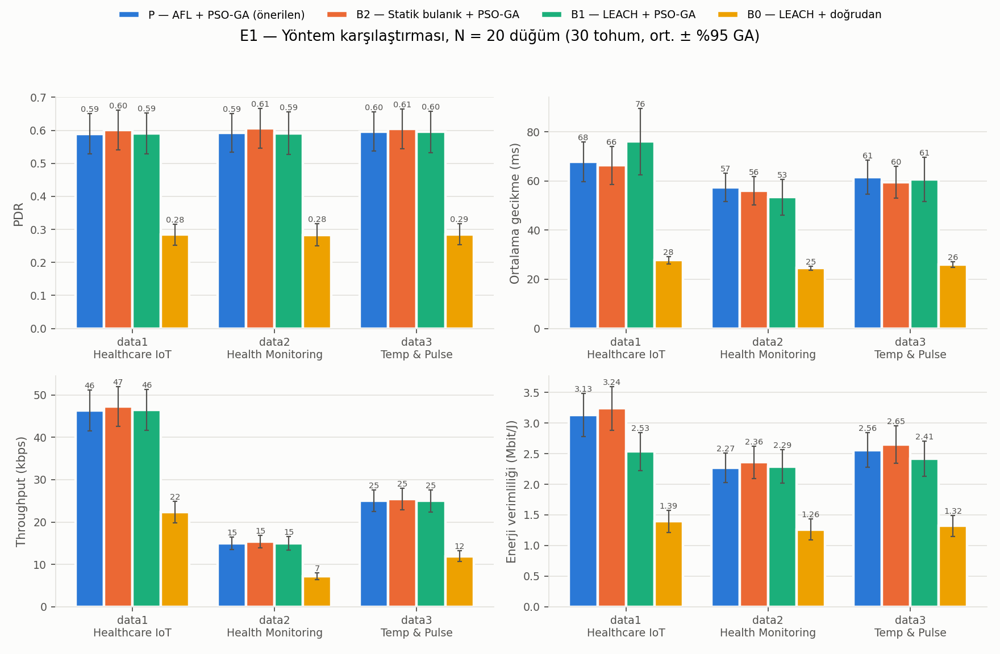
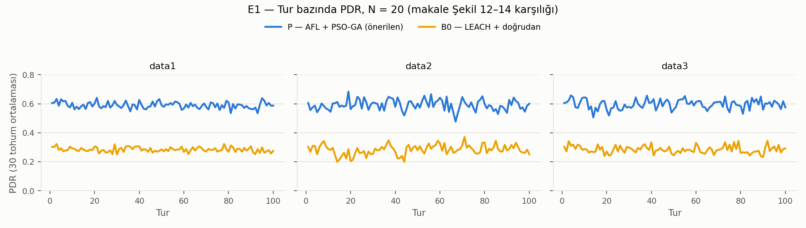
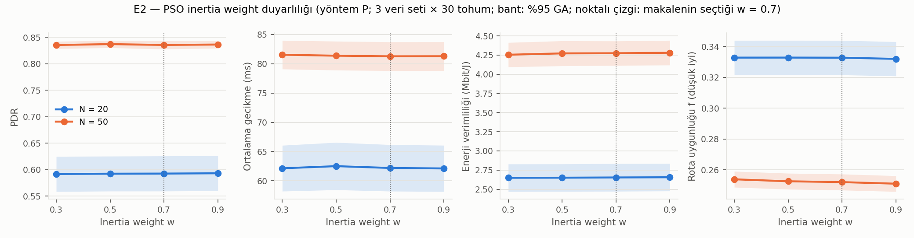
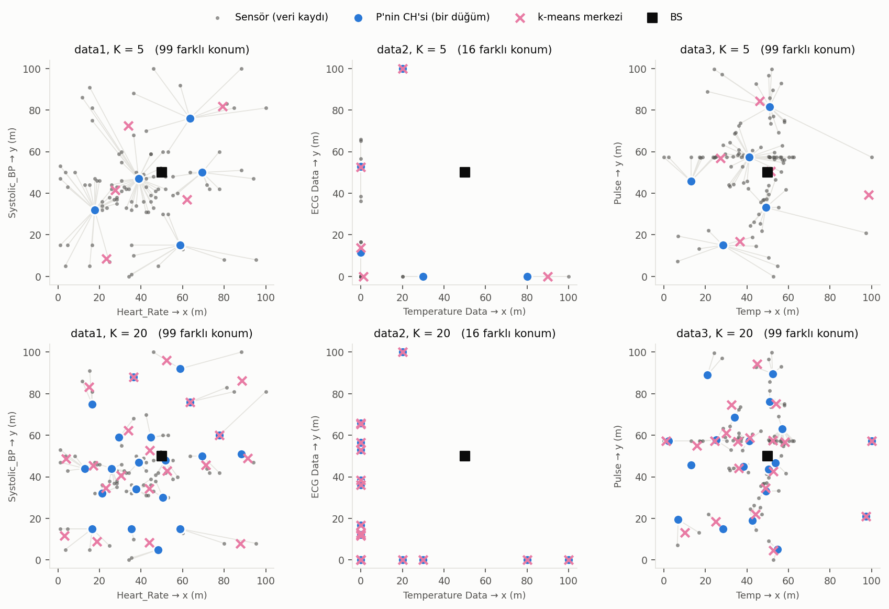
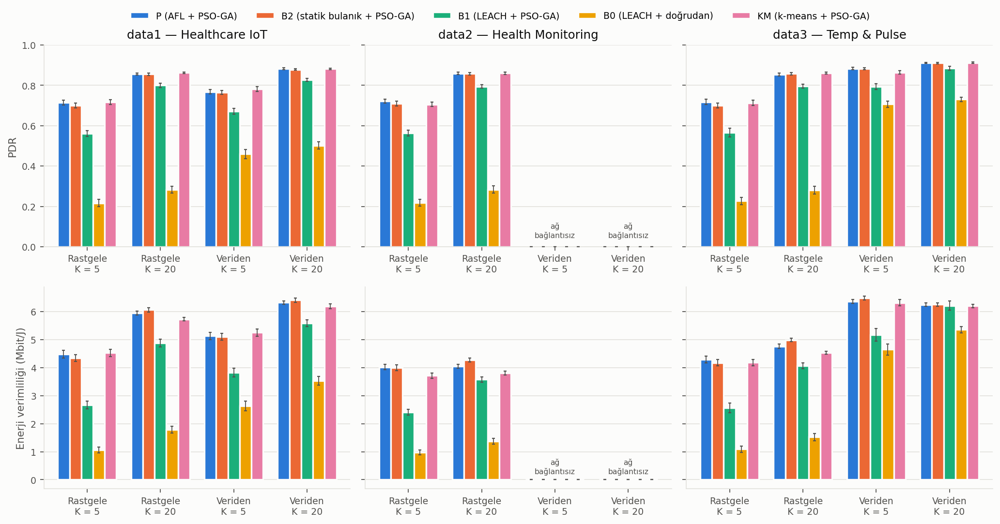

# Checkpoint 3 — Baseline Sistem ve İlk Deney Sonuçları

> **Yönerge (CP3):** Referans makaledeki proje kapsamında belirlenen temel yöntem çalışır duruma getirilecek ve
> ilk deney sonuçları üretilecektir.
>
> Bu aşamada simülatör, AFL tabanlı CH seçimi ve hibrit PSO-GA yönlendirme Checkpoint 2'deki plana göre
> yazıldı, test edildi ve üç deney (E1–E3) çalıştırıldı. Makaledeki "5 ve 20 SN" ifadesinin iki olası yorumu
> ayrıca E6'da test edildi (§11). Makaleye yapılan denklem, tablo ve şekil atıfları
> makalenin kendi numaralarıdır.

---

## 1. Özet

| | |
|---|---|
| Uygulanan | 4 girdili adaptif bulanık CH seçimi, rastgele anahtar kodlamalı PSO-GA, tur tabanlı WSN simülatörü, 3 veri setinden trafik üretimi, LEACH ve statik bulanık karşılaştırmaları |
| Testler | 32 birim testi geçiyor (`python -m unittest discover -s tests -v`) |
| Deneyler | E1 (ana karşılaştırma, 720 koşu), E2 (inertia weight, 720 koşu), E3 (5 düğüm, 360 koşu), E6 ("5/20" yorum testi, 1800 koşu) |
| Süre | E1–E3 ≈ 7 dk, E6 ≈ 12 dk (12 çekirdek, paralel) |

**Ana bulgular:**

1. **Bağlantı sorunu:** Makalenin parametreleriyle (100 × 100 m, 20 düğüm, 25 m menzil) seçilen küme
   başlarının **%39'unun BS'ye çok atlamalı yolu yok.** Bu yüzden PDR ≈ 0.59 çıkıyor (makale: %92.5).
   Düğüm sayısı 50'ye çıkınca bağlantısız CH oranı %2'ye, PDR ise ≈ 0.84'e çıkıyor. 5 düğümde bağlantısız
   CH oranı %81.
2. **Önerilen yöntem (P) klasik LEACH'ten açık ara iyi:** PDR ≈ 2 kat, enerji verimliliği 1.8–2.3 kat
   (p < 0.001).
3. **Ancak kazancın kaynağı yönlendirme.** LEACH + PSO-GA (B1) ile PDR farkı yok. P'nin B1'e üstünlüğü
   enerji verimliliğinde (data1'de %24, data3'te %6; anlamlı), yani bulanık CH seçiminin daha az ve daha iyi
   yerleşmiş küme başı seçmesinden geliyor.
4. **Adaptif MF, statik MF'ye göre avantaj sağlamadı.** 100 turluk koşularda P, statik bulanık (B2)
   yöntemden tutarlı biçimde %1.5–3.8 daha kötü. Farkların çoğu Holm düzeltmesinden sonra anlamlı değil.
5. **Inertia weight (w) ağ metriklerini etkilemiyor.** Makalenin Tablo 10'daki 88.2 → 92.5 PDR farkı
   yeniden üretilemedi.
6. **Ana sonuçlar "5/20"nin nasıl yorumlandığına bağlı değil, tek bir fark dışında** (§11). "5/20 = küme başı
   sayısı" yorumunda (100 sensör) PDR 0.71–0.91'e çıkıyor. Adaptif MF yine statik MF'den iyi değil, B0 yine
   açık ara en kötü. Fark şu: CH sayısı sabitlenince LEACH (B1) küme başlarını rastgele seçtiği için PDR'de de
   geride kalıyor (%3–28). Basit k-means kümeleme de P kadar iyi. Sensörler veri kayıtlarından
   yerleştirildiğinde (makale şekillerinin olası üretimi) data2'de ağ tamamen kopuyor.

## 2. Uygulama

### 2.1 Modüller

| Dosya | İçerik | Makale |
|---|---|---|
| [config.py](../src/afl_wsn/config.py) | Bütün parametreler ve kaynakları | Tablo 3 |
| [network/radio.py](../src/afl_wsn/network/radio.py) | Birinci derece radyo enerji modeli | Denk. 15–16 (düzeltilmiş) |
| [network/link.py](../src/afl_wsn/network/link.py) | Başarı olasılığı p(d), atlama gecikmesi | Denk. 17, 19 |
| [network/topology.py](../src/afl_wsn/network/topology.py) | Rastgele yerleşim, mesafe matrisi | — |
| [traffic.py](../src/afl_wsn/traffic.py) | Veri seti ön işleme, send-on-delta trafik | s. 9 |
| [fuzzy/](../src/afl_wsn/fuzzy/) | MF'ler, 81 kural, çıkarım (CP2) | Denk. 1, 6, 9, 10 |
| [clustering.py](../src/afl_wsn/clustering.py) | AFL / statik bulanık / LEACH CH seçimi, küme oluşumu | Denk. 2–5 |
| [routing.py](../src/afl_wsn/routing.py) | Yol grafiği, uygunluk, PSO-GA, Dijkstra | Denk. 11–22 |
| [simulator.py](../src/afl_wsn/simulator.py) | Tur döngüsü, enerji muhasebesi, metrikler | Algoritma 1, Denk. 23–29 |
| [experiment.py](../src/afl_wsn/experiment.py) | Yöntem tanımları, paralel koşu, istatistik | — |

### 2.2 Plandan sapma: CH seçim kuralı

CP2 §4.7'deki **katı yerel maksimum** kuralı ("menzilindeki bütün adaylardan yüksek skor") ilk denemede
fazla sayıda tek düğümlü küme üretti:

- Bir düğümün en iyi komşusu CH değilse (çünkü o komşunun da daha iyi bir komşusu var), düğümün menzilinde
  hiç CH kalmıyor.
- Bu düğüm kendi kümesinin CH'si olmak zorunda kalıyor.
- Ölçüm: N = 50'de ortalama 18 CH.

Bunun yerine aynı ilkenin **açgözlü** uygulaması kullanıldı:

1. Adaylar skora göre azalan sırada gezilir.
2. Menzilinde (25 m) henüz seçilmiş bir CH yoksa düğüm CH olur.

Sonuç (ön deneme, data1, 5 tohum): N = 50'de ortalama CH sayısı 18'den 10'a indi, enerji verimliliği
4.3'ten 5.1 Mbit/J'ye çıktı. Bu kural "yerel bölgesinde en yüksek
skor" tanımına uyar ve her düğümün menzilinde bir CH olmasını garanti eder (birim testle doğrulandı).

### 2.3 Doğrulama

| Test | Sonuç |
|---|---|
| Radyo modeli (25 m'de 4096 bit) | 4096 × 112.5 nJ = 0.461 mJ ✓ |
| Enerji muhasebesi | Düğüm enerjilerindeki toplam azalma = raporlanan tüketim (9 basamak) ✓ |
| Kusursuz bağlantı + bağlantılı ağ | PDR = 1.0 ✓ |
| Yol çözümleme | Bütün yollar döngüsüz, her atlama menzil içinde ✓ |
| Küme oluşumu | Her düğümün menzilinde CH var; iki CH birbirinin menzilinde değil ✓ |

**PSO-GA'nın kesin optimuma yakınlığı.** Küçük grafiklerde bütün basit yollar kaba kuvvetle sayılıp gerçek
optimum bulundu (15 rastgele topoloji, her birinde 10–12 kaynak CH):

| Düğüm | Kaynak sayısı | PSO-GA optimumu buldu | Dijkstra (toplamsal yaklaşım) optimumu buldu |
|---|---|---|---|
| 12 | 71 | 69 (%97) | 70 (%99) |
| 20 | 101 | 100 (%99) | 88 (%87) |

PSO-GA, gerçek (toplamsal olmayan) uygunluk fonksiyonunu optimize ettiği için 20 düğümde Dijkstra'dan daha
sık optimuma ulaşıyor. Ancak Dijkstra 40–90 kat daha hızlı: N = 20'de dönem başına 24 ms'ye karşı 0.6 ms,
N = 50'de 119 ms'ye karşı 1.4 ms (tek çekirdek, data1, 5 tohum). Ön ölçümde iki yöntemin PDR'si de neredeyse
aynı (N = 20: 0.648 ve 0.639; N = 50: 0.842 ve 0.843). Bu karşılaştırma özgün katkı K6'da 30 tohumla
yapılacak.

## 3. Deney düzeni

| | |
|---|---|
| Alan / BS | 100 × 100 m, BS (50, 50) |
| Düğüm | N = 20 (makale), N = 50 (yoğun senaryo), N = 5 (E3) |
| Tur | 100 (Tablo 3: "100 iterations"), yeniden kümeleme her 10 turda |
| Tohum | 30 (0–29). Aynı tohumda topoloji ve trafik bütün yöntemlerde aynı → eşleştirilmiş karşılaştırma |
| Veri setleri | data1 (5000 satır), data2, data3; trafik yükleri sırasıyla düğüm başına tur başına 0.96, 0.31, 0.51 paket |
| İstatistik | Ortalama ± %95 GA; tohum eşleştirmeli Wilcoxon (Holm düzeltmeli, 72 test) ve paired t-testi |
| Yazılım / donanım | Python 3.13, numpy 2.2.5, scipy 1.15.2; Windows 11, 12 mantıksal çekirdek |

**Yöntemler:**

| Kod | CH seçimi | Yönlendirme |
|---|---|---|
| **P** | Adaptif bulanık (AFL) — makalenin yöntemi | PSO-GA |
| **B2** | Statik bulanık (aynı 81 kural, sabit MF) | PSO-GA |
| **B1** | LEACH (p = 0.1) | PSO-GA |
| **B0** | LEACH | CH → BS doğrudan |

## 4. E1 — Ana karşılaştırma (makale Tablo 4–6)

### 4.1 N = 20 (makalenin senaryosu)

| Veri seti | Ölçüt | P | B2 | B1 | B0 |
|---|---|---|---|---|---|
| data1 | PDR | 0.590 | **0.602** | 0.591 | 0.284 |
| | Gecikme (ms) | 67.8 | 66.4 | 76.1 | **27.7** |
| | Throughput (kbps) | 46.3 | **47.3** | 46.5 | 22.3 |
| | EE (Mbit/J) | 3.13 | **3.24** | 2.53 | 1.39 |
| data2 | PDR | 0.592 | **0.606** | 0.591 | 0.284 |
| | Gecikme (ms) | 57.3 | 55.9 | 53.4 | **24.5** |
| | Throughput (kbps) | 15.0 | **15.4** | 15.0 | 7.2 |
| | EE (Mbit/J) | 2.27 | **2.36** | 2.29 | 1.26 |
| data3 | PDR | 0.596 | **0.605** | 0.595 | 0.285 |
| | Gecikme (ms) | 61.5 | 59.6 | 60.7 | **25.9** |
| | Throughput (kbps) | 25.0 | **25.4** | 25.0 | 12.0 |
| | EE (Mbit/J) | 2.56 | **2.65** | 2.41 | 1.32 |

| Yapısal ölçüt (3 veri seti ortalaması) | P | B2 | B1 | B0 |
|---|---|---|---|---|
| Ortalama CH sayısı | 7.7 | 7.7 | 15.4 | 15.3 |
| BS'ye yolu olmayan CH oranı | 0.39 | 0.39 | 0.35 | 0.82 |
| Rota hesaplama süresi (ms / dönem) | 56–65 | 54–57 | 115–205 | 2 |



**P'nin iyileşme yüzdesi (makale Tablo 7–9 karşılığı)** — pozitif değer P lehine; parantez içinde Holm
düzeltmeli Wilcoxon p değeri:

| Veri seti | Karşı | PDR | Gecikme | Throughput | EE |
|---|---|---|---|---|---|
| data1 | B0 | +107.5 (<0.001) | −144.3 (<0.001) | +107.5 (<0.001) | +124.8 (<0.001) |
| | B1 | −0.3 (1.00) | +10.9 (0.012) | −0.3 (1.00) | +23.7 (<0.001) |
| | B2 | −2.0 (0.053) | −2.1 (0.17) | −2.0 (0.072) | −3.2 (0.001) |
| data2 | B0 | +108.8 (<0.001) | −134.0 (<0.001) | +109.2 (<0.001) | +80.0 (<0.001) |
| | B1 | +0.1 (1.00) | −7.5 (0.006) | +0.2 (1.00) | −0.9 (1.00) |
| | B2 | −2.3 (0.25) | −2.5 (0.13) | −2.3 (0.25) | −3.8 (0.20) |
| data3 | B0 | +109.0 (<0.001) | −136.9 (<0.001) | +109.1 (<0.001) | +93.8 (<0.001) |
| | B1 | +0.2 (1.00) | −1.3 (1.00) | +0.2 (1.00) | +6.1 (<0.001) |
| | B2 | −1.5 (0.20) | −3.2 (0.085) | −1.5 (0.21) | −3.3 (0.065) |

> **B0'ın düşük gecikmesi yanıltıcıdır.** Gecikme yalnızca BS'ye *ulaşan* paketler üzerinden hesaplanır.
> B0'da yalnızca BS'ye 25 m'den yakın CH'lerin paketleri ulaşır; bunlar tek atlamalık kısa yollardır.
> Bu, metriğin bir hayatta kalma yanlılığıdır.



### 4.2 N = 50 (yoğun senaryo)

| Ölçüt (3 veri seti ortalaması) | P | B2 | B1 | B0 |
|---|---|---|---|---|
| PDR | 0.836 | **0.843** | 0.839 | 0.290 |
| EE (Mbit/J) | 4.27 | **4.34** | 3.64 | 1.45 |
| CH sayısı | 9.9 | 10.3 | 26.4 | 26.2 |
| BS'ye yolu olmayan CH oranı | 0.02 | 0.02 | 0.01 | 0.83 |

Tablonun tamamı ve testler: [e1_summary.csv](../results/tables/e1_summary.csv),
[e1_tests.csv](../results/tables/e1_tests.csv), [şekil](../results/figures/e1_metrics_N50.png).

## 5. E2 — Inertia weight duyarlılığı (makale Tablo 10)

Yöntem P, 3 veri seti × 30 tohum (her hücre 90 koşu). Makale hangi veri setini kullandığını belirtmediği için
üç veri setinin ortalaması verilmiştir.

| w | PDR (N=20) | Gecikme ms (N=20) | EE Mbit/J (N=20) | Rota f (N=20) | PDR (N=50) | Rota f (N=50) | *Makale PDR / gecikme* |
|---|---|---|---|---|---|---|---|
| 0.3 | 0.592 | 62.1 | 2.650 | 0.3329 | 0.836 | 0.2539 | *%88.2 / 0.14 s* |
| 0.5 | 0.592 | 62.5 | 2.651 | 0.3329 | 0.837 | 0.2526 | *%90.5 / 0.12 s* |
| **0.7** | 0.593 | 62.2 | 2.654 | 0.3328 | 0.836 | 0.2521 | *%92.5 / 0.10 s* |
| 0.9 | 0.593 | 62.1 | 2.657 | **0.3320** | 0.836 | **0.2510** | *%91.0 / 0.11 s* |

**Friedman testi** (w'nin etkisi):
- PDR, throughput ve EE için hiçbir senaryoda anlamlı değil (p > 0.2).
- Rota uygunluğu yalnızca N = 50'de anlamlı (χ² = 27.3, p < 0.001). Orada en iyi değer w = 0.9, ancak fark
  yalnızca %1.1.
- Gecikme N = 20'de anlamlı çıktı (p = 0.01), ama en büyük fark 0.4 ms.



**Yorum:** Rota grafikleri küçük (20–50 düğüm) olduğu için her w değeri neredeyse optimum yolu buluyor
(§2.3). Bu nedenle w'nin ağ metriklerine etkisi gözlenemiyor. Makaledeki büyük farklar (PDR'de 4.3 puan,
gecikmede %40) bu deney düzeninde yeniden üretilemedi.

## 6. E3 — Küçük ağ: 5 düğüm

| Ölçüt (3 veri seti × 30 tohum) | P | B2 | B1 | B0 |
|---|---|---|---|---|
| PDR | 0.273 | 0.282 | 0.265 | 0.240 |
| BS'ye yolu olmayan CH oranı | 0.81 | 0.81 | 0.81 | 0.84 |
| Ortalama atlama sayısı | 1.04 | 1.03 | 1.04 | 1.00 |

5 düğümde ağ neredeyse hiç bağlantılı değil. Bu durumda yöntemlerin farkı anlamsızlaşıyor. Makalenin 5 düğüm
için raporladığı ~%91 PDR, belirtilen alan ve menzille fiziksel olarak tutarlı değil (CP1, T9). Bu, makaledeki
"5 ve 20 düğüm"ün aslında küme sayısı olabileceği yorumunu güçlendiriyor (CP1, T8). Bu yorum §11'de test
edildi.

## 7. Makaleyle karşılaştırma

| Makalenin iddiası | Bu çalışmadaki bulgu | Uyum |
|---|---|---|
| Önerilen model PDR ≈ %92 (20 düğüm) | 0.59 (N = 20), 0.84 (N = 50) | ✗ — fark büyük ölçüde bağlantısızlıktan (%39 CH) kaynaklanıyor |
| Gecikme ≈ 0.10–0.13 s | 57–68 ms (N = 20), 72–92 ms (N = 50) | ≈ aynı mertebe (makalenin şekilleri: 100–145 ms) |
| Rakip yöntemlere göre PDR +%8–33 | LEACH'e göre +%108; LEACH + PSO-GA'ya göre fark yok | Kısmen — kazanç yönlendirmeden geliyor |
| EE'de +%7–41 | LEACH'e göre +%80–125; LEACH + PSO-GA'ya göre −1 ile +24 | Kısmen |
| Adaptif bulanık CH seçimi temel katkı | Statik bulanık sürüm %1.5–3.8 daha iyi (çoğu anlamsız) | ✗ — bu deney düzeninde desteklenmiyor |
| w = 0.7 en iyi, w'nin etkisi belirgin (Tablo 10) | Etkisi ihmal edilebilir; rota kalitesinde en iyi w = 0.9 | ✗ |
| 5 düğümde de yüksek PDR | %81 CH bağlantısız, PDR 0.27 | ✗ |

**Mutlak değerler hakkında:** Makaledeki mutlak sayılar kendi içinde tutarsız (CP1, T5), modeller de
tanımsız. Bu yüzden karşılaştırma eğilim ve göreli fark düzeyinde yapılmıştır. Throughput ve EE bu çalışmada
fiziksel birimlerle (kbps, Mbit/J) raporlanmıştır ve makalenin tablolarıyla doğrudan kıyaslanamaz.

## 8. Tartışma

**Neden adaptif MF avantaj sağlamadı?**
- 100 turun sonunda bile düğüm enerjileri dar bir bantta kalıyor. Ölçülen ortalama $E_r$ aralıkları (10 tohum):
  data1 0.91–0.98, data2 0.95–0.99, data3 0.94–0.99.
- Adaptif MF bu dar bandı bütün terim aralığına yayıyor. Böylece 0.95 ile 0.98 arasındaki, pratikte önemsiz
  enerji farkları "Düşük" ve "Yüksek" ayrımı gibi davranıp CH seçimine baskın geliyor. Örneğin %95 enerjisi
  olan bir düğüm, en düşük değer o olduğu için "Düşük enerjili" sayılıp CH adaylığında geri plana itiliyor.
- Statik MF'de bütün bu düğümler "Yüksek enerjili"dir; seçim mesafe, yoğunluk ve bağlantı kalitesine göre
  yapılıyor.
- **Hipotez:** Adaptif MF'nin yararı ancak düğümler arasında gerçek enerji farkı oluştuğunda, yani uzun
  koşularda ortaya çıkar. Bu, K1'de ağ ömrü (FND/HND/LND) deneyiyle test edilecek.

**Neden PSO-GA'nın parametreleri önemsiz?**
- Rota uzayı küçük: ortalama 1.9–2.6 atlama.
- PSO-GA vakaların %97–99'unda kesin optimumu buluyor (§2.3). Optimizasyon algoritmasının ayarları bu
  durumda sonucu değiştirmiyor.
- Makalenin metasezgisel yönlendirmeyi bu ölçekte gerekçelendirmesi zayıf; kesin bir algoritma çok daha
  ucuz.

**Bağlantısızlık:**
- Makalenin Tablo 3 parametreleriyle (20 düğüm, 100 × 100 m, 25 m menzil) beklenen komşu sayısı ≈ 3.
  Bu yüzden ağ çoğunlukla bölünmüş.
- Bağlantısız CH'ler BS'ye doğrudan uzun mesafeden göndermek zorunda kalıyor ve bu iletimler neredeyse hep
  başarısız oluyor.
- Makale bu durumu tartışmıyor. Raporladığı yüksek PDR, belirtilen parametrelerle tutarlı değil.

## 9. Sınırlılıklar

- **Kanal modelleri varsayımsal.** Bağlantı, gecikme ve trafik modelleri makalede tanımlı değil; sonuçlar,
  özellikle PDR, bu modellere duyarlıdır. Fitness ağırlıkları ve λ için duyarlılık analizi (E5) henüz
  yapılmadı.
- **Kısa koşular.** 100 tur, düğüm ölümlerini gözlemek için çok kısa. Ağ ömrü deneyi (E4) bir sonraki aşamada.
- **Farklı rakipler.** Makaledeki ANFIS, QPSO ve ECPF yeniden gerçekleştirilmedi (kod yok). Bunların yerine
  aynı simülatörde LEACH tabanlı karşılaştırmalar kullanıldı.
- **İdeal varsayımlar.** Simülasyon tek kanallı ve çarpışmasız; kontrol paketlerinin enerjisi ihmal edildi.

## 10. Checkpoint 4'e girdi

Bu aşamanın bulguları katkı seçimini doğrudan yönlendiriyor:

| Aday | Bu aşamadan gelen gerekçe |
|---|---|
| **K1 — Adaptif ve statik MF, ağ ömrü üzerinden** | Kısa koşularda adaptif MF'nin yararı yok; makalenin ana iddiası ancak enerji farkı oluştuğunda test edilebilir |
| **K6 — Yönlendirme ablasyonu (Dijkstra, PSO, GA, PSO-GA)** | PSO-GA neredeyse her zaman optimumda; Dijkstra 40–90 kat hızlı ve ön ölçümde PDR'si aynı. Metasezgiselin bu ölçekte gerekliliği sorgulanabilir |
| K2 — Mamdani / Sugeno, kural ağırlığı öğrenme | Bulanık çekirdeğin kendisini geliştirmeye yönelik |
| K4 / K5 — Gürültü, ölçeklenebilirlik | N = 50'deki davranış farklı; ölçek etkisi belirgin |

## 11. E6 — Yorum testi: düğüm mü, küme mi?

Makale "5 ve 20 SN" ifadesini iki ayrı anlamda kullanıyor: Tablo 3'te sensör sayısı, Şekil 3–11'de ise yüzlerce
noktanın gruplandığı küme sayısı (CP1, T8 ve T20–T24). Şekillerdeki noktalar da fiziksel konum değil, veri
kayıtlarının fizyolojik değerleri. Bulguların hangi yoruma bağlı olduğunu görmek için iki yorum da test edildi.

| | Yorum A — 5/20 sensör | Yorum B — 5/20 küme başı |
|---|---|---|
| Sensör sayısı | 5 ya da 20 | 100 (makalenin ölçeklenebilirlik örneği "100+ SN") |
| CH sayısı | Serbest (§2.2) | Sabit K ∈ {5, 20} |
| Yerleşim | Düzgün rastgele | Düzgün rastgele **ve** veriden yerleşim |
| Deney | E1 (N = 20), E3 (N = 5) | E6 (bu bölüm) |

### 11.1 Düzen

- **Sabit K:**
  - Bulanık yöntemler (P, B2) en yüksek skorlu K düğümü, birbirinden en az r = A / √(πK) uzakta olacak
    biçimde seçiyor: K = 5'te ≈ 25 m, K = 20'de ≈ 13 m. r, K dairenin alanı kaplaması için gereken yarıçap.
  - LEACH'te p = K/N.
  - Her düğüm, menzil dışında kalsa bile en yakın CH'ye katılıyor; aksi halde CH sayısı K'da kalmaz.
- **KM (k-means + PSO-GA):** Makale şekillerinde küme merkezleri noktaların arasındaki boşlukta duruyor (T24).
  Bu görüntünün karşılığı olarak k-means eklendi. Merkez bir düğüm olmadığı için her kümenin CH'si o kümedeki
  en yüksek enerjili düğüm oluyor; eşitlik varsa merkeze en yakın düğüm seçiliyor.
- **Veriden yerleşim:** Her düğüm bir veri kaydı. Kaydın iki sütunu min-max ile 100 × 100 m'ye ölçekleniyor.
  Düğüm, trafik akışını kendi kaydından itibaren okuyor. Veri setlerinde yaş sütunu olmadığı için şu sütunlar
  kullanıldı:
  - data1: kalp hızı – sistolik tansiyon
  - data2: sıcaklık – ECG
  - data3: sıcaklık – nabız
- **Kapsam:** 100 düğüm, 3 veri seti, 30 tohum, 100 tur, 5 yöntem, 2 yerleşim ve 2 K değeri: toplam 1800 koşu.
  Testler P'ye karşı tohum eşleştirmeli Wilcoxon ile yapıldı (Holm düzeltmeli, 187 test).



Şekil, makalenin Şekil 3–5'ine karşılık geliyor (tohum 0, veriden yerleşim):
- k-means merkezleri (×) makaledeki gibi noktaların arasındaki boşluğa düşüyor; P'nin CH'leri (●) ise her
  zaman bir düğüm.
- data2'de 100 düğüm yalnızca 16 farklı konuma oturuyor. Kayıtların 130/150'sinde ECG = 0 olduğu için
  düğümler alanın kenarlarına diziliyor. data2'nin hiçbir kaydı BS'ye 50 m'den yakın değil.

### 11.2 Sonuçlar



**PDR** (30 tohum ortalaması):

| Yerleşim | K | Veri seti | P | B2 | B1 | B0 | KM |
|---|---|---|---|---|---|---|---|
| Rastgele | 5 | data1 / data2 / data3 | 0.714 / 0.721 / 0.717 | 0.700 / 0.710 / 0.700 | 0.560 / 0.564 / 0.566 | 0.217 / 0.218 / 0.227 | 0.717 / 0.705 / 0.713 |
| Rastgele | 20 | data1 / data2 / data3 | 0.856 / 0.859 / 0.854 | 0.856 / 0.858 / 0.858 | 0.800 / 0.795 / 0.797 | 0.284 / 0.284 / 0.281 | 0.862 / 0.860 / 0.861 |
| Veriden | 5 | data1 / data3 | 0.768 / 0.883 | 0.765 / 0.883 | 0.672 / 0.794 | 0.460 / 0.707 | 0.781 / 0.863 |
| Veriden | 20 | data1 / data3 | 0.882 / 0.912 | 0.879 / 0.910 | 0.827 / 0.885 | 0.502 / 0.730 | 0.882 / 0.912 |
| Veriden | 5 ve 20 | data2 | 0.000 | 0.000 | 0.000 | 0.000 | 0.000 |

**Enerji verimliliği (Mbit/J):**

| Yerleşim | K | Veri seti | P | B2 | B1 | B0 | KM |
|---|---|---|---|---|---|---|---|
| Rastgele | 5 | data1 / data2 / data3 | 4.48 / 4.02 / 4.29 | 4.34 / 4.00 / 4.17 | 2.67 / 2.41 / 2.57 | 1.07 / 0.97 / 1.09 | 4.53 / 3.72 / 4.18 |
| Rastgele | 20 | data1 / data2 / data3 | 5.95 / 4.05 / 4.76 | 6.06 / 4.27 / 4.99 | 4.88 / 3.58 / 4.07 | 1.78 / 1.38 / 1.53 | 5.73 / 3.80 / 4.53 |
| Veriden | 5 | data1 / data3 | 5.13 / 6.36 | 5.10 / 6.48 | 3.83 / 5.18 | 2.63 / 4.65 | 5.26 / 6.32 |
| Veriden | 20 | data1 / data3 | 6.32 / 6.25 | 6.41 / 6.26 | 5.59 / 6.22 | 3.53 / 5.36 | 6.19 / 6.21 |

**P'nin diğer yöntemlere göre iyileşmesi** (üç ya da iki veri setindeki aralık; data2 veriden yerleşim hariç;
\* bütün veri setlerinde Holm sonrası p < 0.05, parantez içinde yalnız anlamlı olanlar):

| Yerleşim | K | vs B0 (PDR) | vs B1 (PDR) | vs B1 (EE) | vs B2 (PDR) | vs B2 (EE) | vs KM (PDR) | vs KM (EE) |
|---|---|---|---|---|---|---|---|---|
| Rastgele | 5 | +216 – 230%\* | +27 – 28%\* | +67 – 68%\* | +1.6 – 2.4% | +0.6 – 3.2% | −0.4 – +2.2% | −1.0 – +8.2% (data2) |
| Rastgele | 20 | +202 – 204%\* | +7 – 8%\* | +13 – 22%\* | −0.4 – +0.1% | −1.9 – −5.3%\* | −0.9 – −0.1% | +3.8 – 6.4%\* |
| Veriden | 5 | +25 – 67%\* | +11 – 14%\* | +23 – 34%\* | +0.1 – 0.4% | −1.8 – +0.7% | −1.7 – +2.3% | −2.4 – +0.7% |
| Veriden | 20 | +25 – 76%\* | +3 – 7%\* | +0.5 – 13% (data1) | +0.2 – 0.4% | −0.2 – −1.3% (data1) | 0.0 – 0.1% | +0.6 – 2.1% (data1) |

**Ek ölçümler (P):**

| | Rastgele, K = 5 | Rastgele, K = 20 | Veriden, K = 5 (data1 / data3) | Veriden, K = 20 (data1 / data3) |
|---|---|---|---|---|
| BS'ye yolu olmayan CH oranı | 0.00 | 0.00 | 0.00 / 0.00 | 0.00 / 0.07 |
| CH'sine 25 m'den uzak üye oranı | 0.29 | 0.04–0.05 | 0.21 / 0.06 | 0.03 / 0.00 |
| Ortalama gecikme (ms) | 98–190 | 69–87 | 247 / 173 | 97 / 71 |

### 11.3 Yorum

1. **Ana sonuçlar yoruma bağlı değil.**
   - P ≈ B2: PDR farkı hiçbir yerde anlamlı değil. EE'de K = 20'de statik MF %1–5 daha iyi; bu fark rastgele
     yerleşimde üç veri setinde, veriden yerleşimde yalnız data1'de anlamlı. Adaptif MF'nin statik MF'ye
     üstünlüğü yorum A'da olduğu gibi yorum B'de de görülmüyor.
   - P ≫ B0 her iki yorumda da geçerli.
2. **Değişen tek şey P ile B1 arasındaki PDR farkı.** Yorum A'da (CH sayısı serbest) LEACH ortalama 15 CH
   seçiyordu ve PDR farkı yoktu. CH sayısı sabitlenince LEACH'in rastgele seçtiği CH'ler kötü yayılıyor. K = 5'te
   B1'de üyelerin %47'si CH'sine 25 m'den uzak kalıyor, P'de %29. Bu yüzden P, PDR'de %3–28 önde. Bu fark
   bulanık skordan değil, CH'lerin alana yayılmasından geliyor (bkz. madde 4).
3. **Yorum B makalenin sayılarına daha yakın.** Yorum A'da (20 sensör) PDR 0.59 ve CH'lerin %39'u
   bağlantısızdı. 100 sensör ve K = 20 CH ile rastgele yerleşimde PDR 0.86, data3 veriden yerleşimde 0.91.
   Makalenin raporladığı %92.5 de data3'e ait (T11). Bu, makalenin aslında çok sayıda düğümle çalışmış olduğu
   yorumunu destekliyor; ama Tablo 3 ile çelişkiyi ortadan kaldırmıyor.
4. **k-means, AFL kadar iyi.** CH sayısı sabitken basit bir merkez tabanlı kümeleme (KM), PDR'de P ile aynı
   sonucu veriyor; EE'de rastgele yerleşimde K = 20'de P %4–6 önde. Bulanık CH seçiminin katkısı büyük ölçüde
   "iyi yayılmış CH seçmek"le sınırlı kalıyor ve bunu k-means de yapıyor. Bu bulgu özgün katkı aşamasında (K1)
   değerlendirilecek.
5. **K = 5 kendi başına kayıplı.** 100 × 100 m alanda 5 CH ile üyelerin yaklaşık %29'u CH'lerine 25 m'den
   uzak kalıyor. Bu iletimlerin çoğu başarısız oluyor ve PDR 0.71–0.72'de kalıyor.
6. **Veriden yerleşim fiziksel olarak tutarsız.**
   - data1 ve data3'te PDR rastgele yerleşimden yüksek çıkıyor, çünkü noktalar kısmen alanın ortasında
     toplanıyor. data3'te imputasyonla medyana çekilen nabız değerleri BS'nin hemen üstünde bir çizgi
     oluşturuyor.
   - data2'de ağ tamamen kopuyor.
   - Konumlar ölçümlerin dağılımına bağlı olduğu için sonuç veri setine göre keyfi biçimde değişiyor. Bu
     yüzden ana deneylerde rastgele yerleşim korunuyor; veriden yerleşim yalnızca makalenin şekillerini
     yorumlamak için kullanıldı.

## Yeniden üretme

Repo kökünden:

```bash
python experiments/baseline/run_e1.py
```

```bash
python experiments/baseline/run_e2.py
```

```bash
python experiments/baseline/run_e3.py
```

```bash
python experiments/baseline/run_e6.py
```

Sonuçlar `results/tables/` ve `results/figures/` altına yazılır. Veri dosyaları `data/` klasöründe olmalıdır
(bkz. [data/README.md](../data/README.md)).
