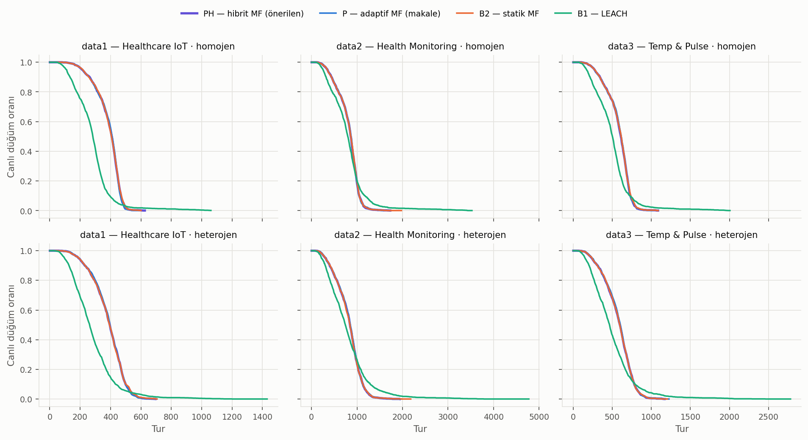
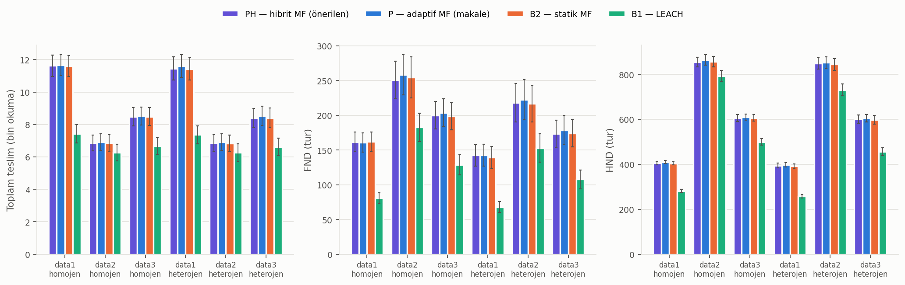
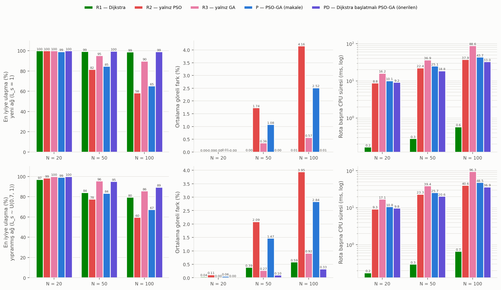
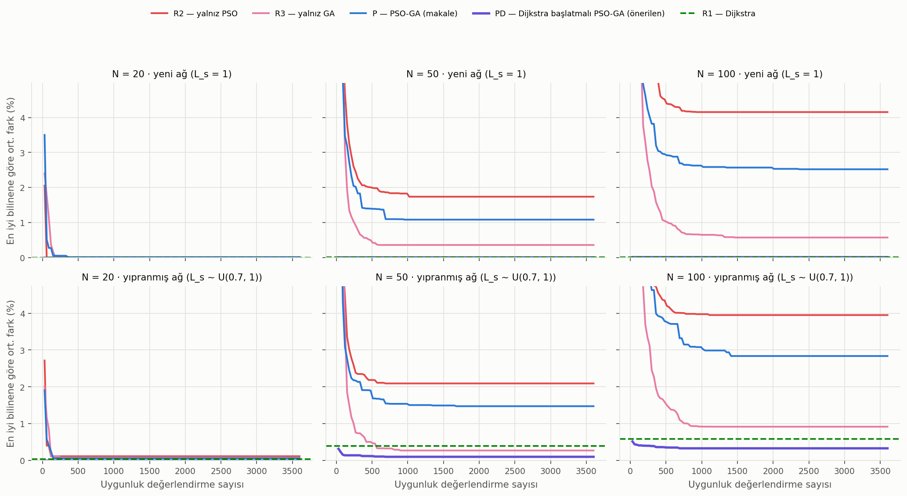
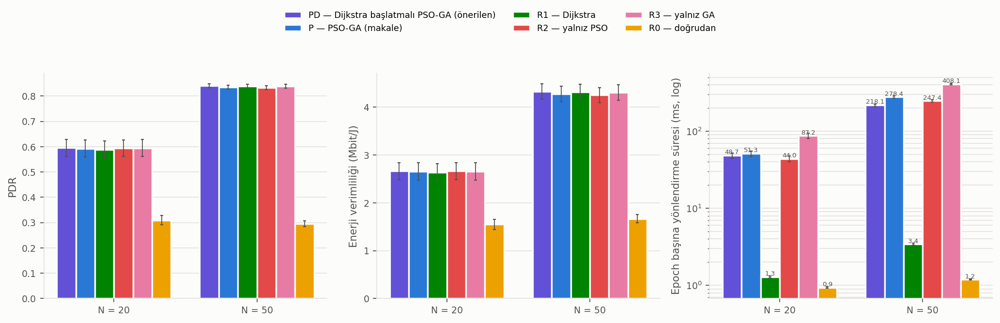

# Checkpoint 5 — Deneysel Sonuçlar

> **Yönerge (CP5):** Baseline ve geliştirilen sistem çalıştırılacak; karşılaştırmalı sonuç tabloları ve grafikler
> hazırlanacaktır.
>
> Bu belge, Checkpoint 4'te tanımlanan iki katkının sonuçlarını veriyor:
> [CP4 — Katkı Önerisi](checkpoint4_katki_onerisi.md).
> - **K1:** Hibrit adaptif MF (PH), ağ ömrü boyunca değerlendirildi.
> - **K6:** Yönlendirme ablasyonu ve Dijkstra başlatmalı PSO-GA (PD).
>
> Hipotezler ve başarı ölçütleri deneylerden önce CP4'te sabitlenmişti. Burada olduğu gibi değerlendiriliyor.

---

## 1. Özet

| Performans ölçütü | Baseline | Geliştirilen yöntem | Değişim |
|---|---|---|---|
| **K1** — Ağ ömrü boyunca teslim edilen okuma (6 hücre ortalaması) | P: 9020 | PH: 8945 | −0.8% (anlamsız) |
| K1 — İlk düğüm ölümü, FND (tur) | P: 194.5 | PH: 191.0 | −1.8% (anlamsız) |
| K1 — Yarı düğüm ölümü, HND (tur) | P: 623.2 | PH: 618.5 | −0.7% (anlamsız) |
| **K6** — En iyi bilinen rotaya ulaşma, N = 100, yıpranmış ağ | P: %67.3 | PD: %89.5 | +22.2 puan |
| K6 — En iyi bilinene göre ortalama fark, N = 100, yıpranmış ağ | P: %2.84 | PD: %0.33 | 8.6 kat küçük |
| K6 — Rota başına CPU süresi, N = 100, yıpranmış ağ | P: 48.5 ms | PD: 36.9 ms | −24% |
| K6 — Uygunluk değerlendirme sayısı, N = 100, yıpranmış ağ | P: 846 | PD: 714 | −16% |
| K6 — Ağ düzeyinde PDR, N = 50 | P: 0.836 | PD: 0.841 | +0.6% (anlamsız) |
| K6 — Epoch başına yönlendirme süresi, N = 50 | P: 278 ms | PD: 218 ms | −22% (p < 0.05) |

**Ana bulgular:**

1. **K1 başarı ölçütünü karşılamadı.** Hibrit MF, ağ ömrü boyunca ne adaptif MF'den ne statik MF'den anlamlı
   biçimde iyi. Ayar aşamasında da ρ'nun hiçbir değeri saf adaptif MF'yi geçemedi.
2. **Ağ ömrü ölçeğinde adaptif MF statik MF'nin biraz önüne geçti.** 100 turluk koşularda (CP3) %1.5–3.8
   gerideydi. Ağ ölene kadar koşulduğunda toplam teslimde %0.4–1.5 önde, ama yalnızca bir hücrede anlamlı.
   Bütün bulanık varyantlar arasındaki fark %1.5'in altında.
3. **K6 başarı ölçütünü karşıladı.** PD, en iyi rotayı her ağ boyutunda P'den daha sık buluyor, daha az
   değerlendirme ve daha kısa sürede. Dijkstra'nın yolundan kötü bir sonuç hiçbir zaman vermiyor.
4. **Ağ düzeyinde optimizasyon algoritmasının seçimi önemsiz.** Dijkstra, PSO, GA, PSO-GA ve PD aynı PDR ve
   enerji verimliliğini veriyor; aralarında anlamlı fark yok. Dijkstra 40–81 kat daha ucuz. Çok atlamalı
   yönlendirmenin kendisi ise çok önemli: doğrudan iletime göre PDR +%89–184.

## 2. K1 — Hibrit adaptif MF ve ağ ömrü

### 2.1 Düzen (CP4 §2.4)

- **Ağ:** N = 50 düğüm, E₀ = 0.25 J, son düğüm ölene kadar.
- **Enerji senaryoları:** homojen (bütün düğümler 0.25 J) ve heterojen (0.125–0.375 J).
- **Yöntemler:** PH (hibrit MF), P (adaptif MF), B2 (statik MF), B1 (LEACH); hepsi PSO-GA yönlendirme.
- **Tekrar:** 3 veri seti × 30 test tohumu = 720 koşu. ρ ayarı için 10 ayrı tohumda 240 koşu.
- **İstatistik:** Wilcoxon, Holm düzeltmesi (144 test).

### 2.2 ρ ayarı (ayar tohumları 100–109)

| ρ | Toplam teslim / P | Ortalama toplam teslim | Ortalama HND |
|---|---|---|---|
| 0 (P, referans) | 1.0000 | — | — |
| 0.25 | 0.9965 | 8881 | 642.0 |
| 0.50 | 0.9934 | 8858 | 641.3 |
| 0.75 | **0.9965** | 8880 | 638.1 |

CP4 §2.3'teki kurala göre oranı en yüksek olan ρ = 0.75 seçildi. 0.25 ile aradaki fark 0.00004, yani pratikte
eşit. Asıl dikkat çeken nokta, **ρ'nun hiçbir değerinin saf adaptif MF'yi (ρ = 0) geçememesi.** Bu, test
sonuçlarından önce olumsuz bir işaretti.

### 2.3 Sonuçlar (test tohumları 0–29)





**Toplam teslim edilen okuma** (30 tohum ortalaması):

| Senaryo | Veri seti | PH | P | B2 | B1 |
|---|---|---|---|---|---|
| Homojen | data1 | 11 624 | 11 651 | 11 609 | 7 428 |
| Homojen | data2 | 6 861 | 6 915 | 6 862 | 6 275 |
| Homojen | data3 | 8 477 | 8 521 | 8 488 | 6 681 |
| Heterojen | data1 | 11 452 | 11 599 | 11 430 | 7 368 |
| Heterojen | data2 | 6 850 | 6 910 | 6 833 | 6 265 |
| Heterojen | data3 | 8 404 | 8 526 | 8 410 | 6 623 |

**Ağ ömrü (tur):**

| Senaryo | Veri seti | FND: PH / P / B2 / B1 | HND: PH / P / B2 / B1 | LND: PH / P / B2 / B1 |
|---|---|---|---|---|
| Homojen | data1 | 162 / 161 / 162 / 81 | 406 / 410 / 404 / 282 | 500 / 486 / 502 / 655 |
| Homojen | data2 | 251 / 258 / 255 / 183 | 855 / 864 / 857 / 792 | 1215 / 1197 / 1241 / 2033 |
| Homojen | data3 | 200 / 203 / 198 / 129 | 606 / 610 / 607 / 500 | 812 / 798 / 818 / 1198 |
| Heterojen | data1 | 142 / 143 / 140 / 68 | 394 / 398 / 391 / 257 | 565 / 552 / 576 / 755 |
| Heterojen | data2 | 218 / 223 / 217 / 153 | 849 / 852 / 845 / 730 | 1357 / 1338 / 1374 / 2338 |
| Heterojen | data3 | 173 / 179 / 174 / 108 | 601 / 605 / 598 / 456 | 906 / 904 / 901 / 1426 |

**İyileşme yüzdeleri** (6 hücredeki aralık; * bütün hücrelerde Holm sonrası p < 0.05, aksi halde anlamlı olan
hücreler parantez içinde):

| Karşılaştırma | Toplam teslim | FND | HND | LND | PDR |
|---|---|---|---|---|---|
| PH – P | −1.4 ile −0.2 | −3.0 ile +0.5 | −1.1 ile −0.4 | +0.2 ile +3.0 (homojen data1) | −1.0 ile −0.2 |
| PH – B2 | −0.1 ile +0.2 | −1.5 ile +2.0 | −0.2 ile +0.7 | −2.1 ile +0.5 | +0.1 ile +0.2 |
| PH – B1 | +9.3 ile +56.5\* | +37.1 ile +109.5\* | +7.9 ile +53.4\* | −42.0 ile −23.6 (6 hücreden 5'i) | +8.2 ile +14.4\* |
| P – B2 (H1a) | +0.4 ile +1.5 (heterojen data1) | −0.7 ile +2.7 | +0.5 ile +1.7 | −4.1 ile +0.3 (homojen data1, data2) | +0.4 ile +1.2 (heterojen data1) |

**CH sayısının turlar boyunca standart sapması** (kararlılık, düşük daha iyi):

| | PH | P | B2 | B1 |
|---|---|---|---|---|
| Homojen | 2.63–3.07 | 2.28–2.91 | 2.66–3.09 | 13.3–15.0 |
| Heterojen | 3.16–3.30 | 2.82–3.13 | 3.17–3.25 | 12.9–14.2 |

### 2.4 Başarı ölçütünün değerlendirilmesi

| CP4 ölçütü | Sonuç |
|---|---|
| 6 hücrenin en az yarısında PH, P ya da B2'den anlamlı biçimde iyi | ✗ — hiçbir hücrede anlamlı biçimde iyi değil |
| Hiçbir hücrede ikisinden de anlamlı biçimde kötü değil | ✓ |
| **Sonuç** | **Karşılanmadı** |

### 2.5 Tartışma

**Hibrit MF neden işe yaramadı?**

- CP3'te bulunan bozulma ağın başında ortaya çıkıyor: enerjiler neredeyse eşitken adaptif MF küçük farkları
  büyütüyor. Ama bu dönemde düğümlerin hepsi dolu olduğu için yanlış CH seçiminin ağ ömrüne etkisi muhtemelen
  küçük.
- İlk ölümlerden sonra enerjiler geniş bir aralığa yayılıyor ve adaptif bölümleme gerçek bilgi taşımaya
  başlıyor. Hibrit MF bu bilgiyi statik MF'ye doğru çekerek zayıflatıyor. Sonuçlar da bunu gösteriyor:
  ρ = 0.75 ile PH, statik MF ile neredeyse aynı (fark ±%0.2).
- **Daha temel bir neden: MF değişikliğinin CH seçimine etkisi sınırlı.**
  - CH seçimi yalnızca skorların sıralamasını kullanıyor (açgözlü seçim, CP3 §2.2).
  - Statik, adaptif ve hibrit bölümlemelerin üçü de her girdide monoton. Daha yüksek enerji hiçbir zaman daha
    düşük "Yüksek" üyeliği vermiyor.
  - Tek bir girdiye uygulanan monoton bir dönüşüm, o girdiye göre sıralamayı değiştirmez. Sıralama yalnızca
    girdiler arasındaki göreli ağırlık değiştiğinde değişir, örneğin enerjinin mesafeye göre ne kadar
    önemli sayıldığı.
  - Bu yüzden üç bulanık varyant arasındaki fark %1.5'i geçmiyor. Bulanık ve LEACH arasındaki fark ise %9–56.

**Adaptif MF ile statik MF (H1a):**

- 100 turda adaptif MF geride, ağ ömrü boyunca biraz önde. Bu, CP3'teki "adaptasyon ancak enerji farkı
  oluşunca işe yarar" hipoteziyle tutarlı.
- Etkisi küçük: toplam teslimde %0.4–1.5. Heterojen senaryoda biraz daha büyük (%1.1–1.5), ama yalnızca
  heterojen data1'de anlamlı.
- Adaptif MF CH sayısını en kararlı tutan varyant: CH sayısının standart sapması statik MF'ye göre %4–14 daha düşük.
- **Makalenin "adaptif MF CH seçimini belirgin biçimde iyileştirir" iddiası bu deneyle desteklenmiyor.**
  Uzun vadede küçük ve çoğunlukla anlamsız bir avantaj var.

**LEACH'in son düğüm ölümü (LND) neden en geç?**

LEACH'in ağ ömrü eğrisinin uzun bir kuyruğu var: birkaç düğüm, ağın geri kalanı öldükten sonra yüzlerce tur
daha yaşıyor. Bunun nedenini ayrıca ölçmedim. Olası açıklama, LEACH'in CH rolünü enerjiye bakmadan rastgele
dağıtması: bazı düğümler daha az CH olup daha az enerji harcıyor. Ağ o noktada pratikte işlevsiz; LEACH'in
toplam teslimi bulanık yöntemlerden %9–56 düşük. Bu yüzden LND tek başına
ağ ömrünü iyi ölçmüyor; FND, HND ve toplam teslim daha anlamlı.

## 3. K6 — Yönlendirme ablasyonu ve Dijkstra başlatmalı PSO-GA

### 3.1 Düzen (CP4 §3.4)

- **A — Algoritma düzeyi:**
  - N ∈ {20, 50, 100}, her biri 30 topoloji. AFL'nin ilk turda seçtiği her CH için bütün yöntemler
    çalıştırıldı (toplam 7735 rota).
  - Ek koşul olarak iki bağlantı durumu kullanıldı: yeni ağ (her düğümde L_s = 1) ve yıpranmış ağ
    (L_s ~ U(0.7, 1)). Yeni ağda uygunluğun L terimi sabit olduğu için Dijkstra'nın toplamsal yaklaşımı
    neredeyse kesin oluyor; bu Dijkstra'yı kayırırdı. CP3'teki optimum testi de değişken L_s kullanıyordu.
    Bu koşul CP4'te yoktu, karşılaştırmanın adil olması için eklendi.
  - En iyi bilinen çözüm: N = 20'de kaba kuvvet (kesin optimum). N = 50 ve 100'de bütün yöntemlerin ve
    100 parçacıklı, 300 iterasyonluk PD koşusunun en iyisi.
- **B — Ağ düzeyi:** E1 düzeni (N ∈ {20, 50}, 100 tur, 3 veri seti × 30 tohum), 6 yöntem, 1080 koşu.

### 3.2 Algoritma düzeyi sonuçlar



**En iyi bilinen çözüme ulaşma oranı (%):**

| Ağ | N | R1 Dijkstra | R2 PSO | R3 GA | P PSO-GA | **PD** |
|---|---|---|---|---|---|---|
| Yeni | 20 | 100 | 100 | 100 | 99.2 | **100** |
| Yeni | 50 | 99.3 | 81.6 | 95.2 | 84.6 | **99.7** |
| Yeni | 100 | 98.8 | 58.4 | 89.9 | 65.3 | **99.1** |
| Yıpranmış | 20 | 97.0 | 98.5 | 100 | 99.3 | **100** |
| Yıpranmış | 50 | 84.2 | 77.7 | 95.5 | 83.5 | **95.2** |
| Yıpranmış | 100 | 79.5 | 59.7 | 85.8 | 67.3 | **89.5** |

**Ortalama göreli fark (%) ve maliyet:**

| Ağ | N | Fark: R1 / R2 / R3 / P / PD | Değerlendirme: R2 / R3 / P / PD | CPU ms: R1 / R2 / R3 / P / PD |
|---|---|---|---|---|
| Yeni | 20 | 0.00 / 0.00 / 0.00 / 0.01 / 0.00 | 634 / 639 / 699 / 690 | 0.17 / 8.8 / 16.2 / 10.1 / 9.2 |
| Yeni | 50 | 0.00 / 1.74 / 0.36 / 1.08 / 0.00 | 694 / 701 / 770 / 692 | 0.28 / 22.4 / 36.9 / 25.1 / 18.8 |
| Yeni | 100 | 0.01 / 4.16 / 0.57 / 2.52 / 0.01 | 740 / 803 / 831 / 690 | 0.58 / 37.9 / 88.6 / 43.7 / 33.0 |
| Yıpranmış | 20 | 0.04 / 0.11 / 0.00 / 0.06 / 0.00 | 635 / 638 / 695 / 690 | 0.18 / 9.3 / 17.1 / 10.8 / 9.8 |
| Yıpranmış | 50 | 0.39 / 2.09 / 0.27 / 1.47 / 0.10 | 685 / 713 / 771 / 701 | 0.30 / 23.3 / 39.4 / 25.7 / 20.6 |
| Yıpranmış | 100 | 0.59 / 3.95 / 0.92 / 2.84 / 0.33 | 731 / 792 / 846 / 714 | 0.67 / 40.6 / 96.3 / 48.5 / 36.9 |

PD'nin Dijkstra'dan kötü sonuç verdiği rota sayısı: 1547 PD rotasından **0** (CP4 §3.2'deki garanti).



*Yakınsama eğrileri, değerlendirme sayısına karşı o ana kadarki en iyi uygunluğun en iyi bilinene göre farkını
gösteriyor. Algoritmalar erken durma kuralıyla (20 iterasyon iyileşme yoksa) yaklaşık 650–850 değerlendirmede
duruyor; eğrilerin sonrası sabit.*

### 3.3 Ağ düzeyi sonuçlar



| N | Ölçüt | PD | P | R1 | R2 | R3 | R0 |
|---|---|---|---|---|---|---|---|
| 20 | PDR | 0.595 | 0.593 | 0.588 | 0.595 | 0.594 | 0.310 |
| 20 | EE (Mbit/J) | 2.66 | 2.65 | 2.63 | 2.66 | 2.66 | 1.55 |
| 20 | Yönlendirme süresi (ms/epoch) | 48.7 | 51.3 | 1.3 | 44.0 | 87.2 | 0.9 |
| 50 | PDR | 0.841 | 0.836 | 0.840 | 0.834 | 0.839 | 0.296 |
| 50 | EE (Mbit/J) | 4.32 | 4.27 | 4.31 | 4.25 | 4.30 | 1.67 |
| 50 | Yönlendirme süresi (ms/epoch) | 218 | 278 | 3.4 | 247 | 408 | 1.2 |

Eşleştirilmiş testlerde (Holm düzeltmeli, 180 test):

- PD, P, R1, R2 ve R3 arasında PDR, gecikme, EE ve throughput açısından **hiçbir anlamlı fark yok.**
- P, doğrudan iletime (R0) göre PDR'de +%89–184, EE'de +%67–162 önde (anlamlı).
- Yönlendirme süresi farklarının hepsi anlamlı, tek istisna PD – P (N = 20).
  - P, Dijkstra'dan 40 (N = 20) ve 81 kat (N = 50) yavaş.
  - PD, P'den N = 50'de %21–22 hızlı.
  - Yalnız GA (R3), P'den 1.5–1.7 kat yavaş.

### 3.4 Başarı ölçütünün değerlendirilmesi

| CP4 ölçütü | Sonuç |
|---|---|
| Üç N değerinin hepsinde en iyiye ulaşma oranı P'den yüksek ya da eşit | ✓ — iki ağ koşulunda da, her N'de |
| Ortalama değerlendirme sayısı P'den düşük | ✓ — 690–714, P'de 695–846 |
| Ağ düzeyinde hiçbir ölçütte P'den anlamlı biçimde kötü değil | ✓ |
| **Sonuç** | **Karşılandı** |

### 3.5 Tartışma

**PSO-GA'nın bileşenleri (H2a):**
- GA bileşeni PSO'ya katkı sağlıyor: N ≥ 50'de P, yalnız PSO'dan (R2) daha sık en iyiye ulaşıyor (%84–85'e
  karşı %78–82; %65–67'ye karşı %58–60).
- Ama **yalnız GA (R3), hibritten daha iyi:** %86–96 ulaşma oranı. Bu bütçe ve erken durma kuralıyla PSO
  bileşeni, GA'nın keşfini kısıtlıyor gibi görünüyor.
- R3'ün bedeli süre: P'nin yaklaşık 1.5–2 katı.
- Erken durma için sabır değeri (20 iterasyon) makalede yok, bu projede varsayıldı. Sıralama bu değere duyarlı
  olabilir (§5).

**Dijkstra neden bu kadar iyi (H2b)?**
- Uygunluk fonksiyonunun dört teriminden üçü (enerji, gecikme, −log PDR) toplamsal. Yalnızca bağlantı
  kararlılığı terimi ortalama olarak tanımlı.
- Yeni ağda bu terim sabit olduğu için Dijkstra neredeyse kesin (%99).
- Yıpranmış ağda yaklaşım bozuluyor (%80–97), ama bulduğu yol optimumdan ortalama yalnızca %0.04–0.59 kötü.

**PD neden işe yarıyor (H2c)?**
- PD, Dijkstra'nın neredeyse optimal çözümünden başlıyor. Geriye kalan iş, ortalama terimin yarattığı küçük
  farkları düzeltmek. Rastgele başlayan PSO-GA bunu ancak çok daha uzun aramayla yapabiliyor.
- İyi başlangıç, erken durmayı da hızlandırıyor. PD neredeyse her zaman 20 iterasyonda duruyor; maliyeti
  bu yüzden P'den düşük.

**Ağ düzeyinde neden fark yok?**
- Algoritma düzeyindeki farklar, uygunlukta en çok %3–4. Rotalar ortalama 2–3 atlamalı. Bu kadar küçük
  uygunluk farkları PDR ve EE'ye yansımıyor.
- Ağ performansını belirleyen şey, çok atlamalı yönlendirme yapılıp yapılmadığı (R0 ile diğerleri arasında 2–3
  kat fark).

**Pratik sonuç:** Bu ölçekte Dijkstra yeterli. Metasezgisel bir optimizasyon gerekiyorsa da Dijkstra
başlatmalı sürüm, makaledeki PSO-GA'dan hem daha doğru hem daha ucuz.

## 4. Hipotezlerin özeti

| Hipotez (CP4) | Sonuç |
|---|---|
| H1a — Ağ ömrü boyunca adaptif MF statik MF'den iyi | Kısmen: toplam teslimde 6 hücrenin 6'sında önde (%0.4–1.5), yalnızca 1'inde anlamlı |
| H1b — Hibrit MF, P ve B2'den kötü değil | ✓ kötü değil, ama iyi de değil; başarı ölçütü karşılanmadı |
| H2a — GA bileşeni PSO'ya katkı sağlar | ✓ (N ≥ 50). Yalnız GA ise hibritten de iyi |
| H2b — Dijkstra ağ düzeyinde PSO-GA'ya eşit, çok daha ucuz | ✓ fark yok, 40–81 kat ucuz |
| H2c — PD, Dijkstra'dan kötü değil ve en iyiye P'den sık ulaşır | ✓ ihlal sayısı 0; ulaşma oranı her koşulda P'den yüksek |

## 5. Sınırlılıklar

- **Model varsayımları:** Kanal, bağlantı, gecikme ve trafik modelleri varsayımsal (CP2). Sonuçlar mutlak
  değerler olarak değil, aynı simülatördeki göreli karşılaştırmalar olarak okunmalı.
- **Erken durma:** PSO tabanlı yöntemlerin sabrı 20 iterasyon. Daha uzun aramada P ve R2 iyileşebilir; ama o
  zaman maliyet farkı da büyür.
- **K6'nın en iyi bilinen çözümü:** N = 50 ve 100'de en iyi bilinen çözüm kesin optimum değil, uzun bir
  aramanın sonucu. Ulaşma oranları bu referansa göre.
- **K1'in ölçeği:** Yalnızca N = 50 ve E₀ = 0.25 J denendi. Daha büyük ağlarda ya da farklı enerji
  dağılımlarında MF'nin etkisi farklı olabilir.
- **ρ seçimi:** Ayar 10 tohumla yapıldı; ρ değerleri arasındaki farklar gürültü düzeyinde.

## Yeniden üretme

Repo kökünden:

```bash
python experiments/proposed/run_k1.py
```

```bash
python experiments/proposed/run_k6.py
```

Süreler (12 çekirdek): K1 yaklaşık 40 dakika (LEACH'in uzun ağ ömrü koşuları en yavaş kısım), K6 yaklaşık
4 dakika. Analizi ve grafikleri koşuları tekrarlamadan yeniden üretmek için iki betik de `--analyze`
seçeneğini kabul eder.
